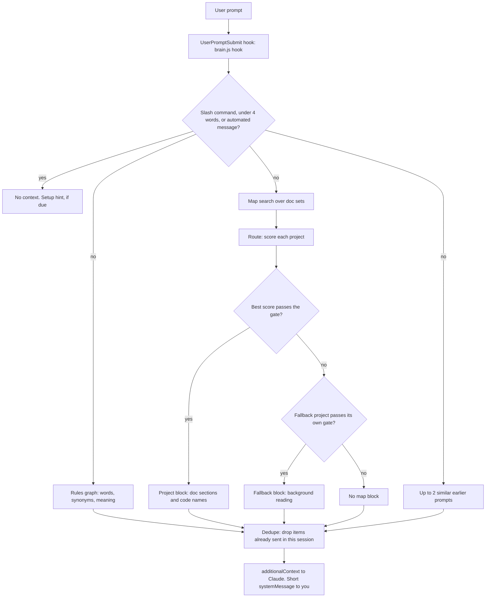
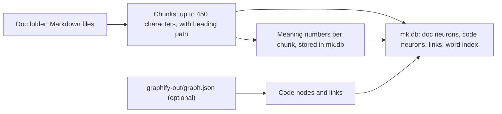
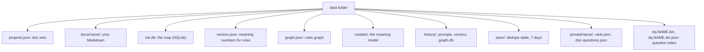

# Architecture

For the step-by-step flows, with diagrams, see [WORKFLOWS.md](WORKFLOWS.md).

How gabriel works inside. Read the [README](../README.md) first.

gabriel has two parts:

- **Rules graph.** Short rules and memory notes from your host's rules folder (`~/.claude` for Claude Code).
- **Map.** Doc sections and code names from your doc folders.

A graph is a set of nodes joined by links. gabriel calls each node a "neuron" in its code and in its map search.

## How a prompt is handled

Each time you send a prompt, Claude Code runs the `UserPromptSubmit` hook (`hooks/hooks.json`). The hook runs `src/brain.js hook`.

Prompts that start with `/`, have fewer than 4 words, or look like harness messages skip the search.

Codex CLI, Gemini CLI and other tools run the same steps through their own adapter in `src/hosts/`. Each adapter reads the host's input and writes the host's output. See [HOSTS](HOSTS.md).

The hook never blocks a prompt. Any error means it prints nothing. The hook timeout is 60 seconds. The map search is skipped when the hook is already past 11 seconds. The meaning step gives up after 9 seconds.

## Rules graph

- **Sources.** The files named in `ruleFiles` in `projects.json`. With no setting, the host's default file: `CLAUDE.md` in `~/.claude` (Claude Code), `AGENTS.md` in `~/.codex` (Codex CLI), `GEMINI.md` in `~/.gemini` (Gemini CLI). It also reads memory notes under `projects/*/memory/` in the same folder, except `MEMORY.md`. When that folder has no `preferences.md`, it adds the plugin's `defaults/preferences.md` (general working rules). Put your own `preferences.md` there to replace them.
- **Nodes.** Each bullet or paragraph is one node. The nearest heading is its section.
- **Note headers.** A note can set `valid-until: YYYY-MM-DD` to drop out after that day. It can set `supersedes: <note name>` to drop an older note.
- **Skipped lines.** A line with `key`, `token`, `secret` or `password` and a long value is never stored.
- **Already in context.** Nodes from the host's always-loaded file (`CLAUDE.md`, `AGENTS.md` or `GEMINI.md`) and files it imports are loaded every session. gabriel never injects them again.
- **Matching.** Words count with an inverse-frequency weight. Synonyms from `src/thesaurus.json` count half. A node passes in one of two ways. It has 2 or more matching words with a total score of at least 2.5. Or it has one strong exact term: 8 or more characters, a dash or dot in it, and an inverse-frequency weight of 3 or more. Rule code: `src/rules.js` `wordScores()`.
- **Meaning.** A small local model scores each node against the prompt. A meaning score needs to reach 0.3 unless words already matched.
- **Output.** Up to 6 rules. The block stays under 2400 characters. Each rule line is cut at 320 characters.
- **Storage.** `graph.json` in the data folder for Claude Code, and `graph.<host>.json` for the other hosts. It is rebuilt when a source file changes.

## Map build

The map is built from each doc set (a "project") in `projects.json`.

- **Which files.** `layout: "auto"` reads `technical-docs/` when it exists. Otherwise it reads every doc file of the default types (`src/extract.js`), except tool folders (`graphify-out`, `node_modules`, `.git`, `atlas`, `_tools`). `layout: "technical-docs"` reads only that folder. `layout: "all-md"` reads every doc file except `skipDirs`.
- **Chunks.** Text is split at headings and at spaces. Each chunk is at most 450 characters and keeps its heading path.
- **Code nodes.** When a project sets `graph`, the file is read from the project root. If that file is missing, the build stops before it writes, and the old map stays. Links get a weight by relation: `calls` and `implements` 1.0, `method` 0.7, `defines` 0.6, `contains` 0.5, `references` 0.3, `imports` 0.2. The full table is `REL` in `src/mk.js`.
- **Doc-to-code links.** A doc section links to a code node when it cites the node's file path, or names it in backticks: a capitalized name (`TireRepair`), or a name of 4+ characters that is camelCase or ends in `()` (`addDocs()`). A name that matches more than 3 nodes does not link.
- **Code check.** After the build, if under 1% of the doc sections link to code, a `warning:` line says the code graph may be the wrong repo. The build still finishes. See [TROUBLESHOOTING](TROUBLESHOOTING.md).
- **One file.** All projects share `mk.db`. Each row has a project tag. A build writes a temporary file, then replaces only the rows of the project it builds. Rows of a removed project stay until `mk.db` is deleted.
- **Learned links.** A rebuild keeps learned links that still point to a node. It drops the rest.
- **Build command.** `node src/brain.js build-mk [name|all]`. Setup runs it for each project.
- **Background rebuild.** The hook checks for changes at most once a minute. The check goes through the doc sets in order and starts the first stale one. A set whose graph file is missing is skipped. The old map keeps serving until the new one is ready. The lock file `mk.lock` names the set being built and counts as held for 10 minutes.
- **Relink.** `add-docs <name> --code <repo> --relink` sets only the `graph` entry of one set, then rebuilds its map. See [ADDING-DOCS](ADDING-DOCS.md).
- **New doc folders.** In the same check, a new folder under `docs/` that holds at least one file starts `setup.js --update` in the background. That adds it as a doc set and builds its map. The lock `docs-add.lock` stops a second run for 10 minutes. An empty folder is ignored.

## Firing: the spreading search

For each prompt, the map search does this:

1. **Seeds.** Doc chunks and code nodes get a score from matching words (with synonyms). Doc chunks also get a score from meaning. Up to 30 doc seeds and 30 code seeds are kept. Code nodes with more than 800 links are never seeds.
2. **Spread.** The score moves along links for 3 rounds. Each step keeps the damping factor 0.55. Each step keeps at most 300 neurons.
3. **Gate.** The best score must reach 0.65. Otherwise the map shows nothing. A question close in meaning to a section title (0.52 or more) can pass the gate alone.
4. **Output.** Up to 6 doc chunks and 6 code names, in at most 2200 characters.
   - A doc line shows the file, the section and the text (cut at 210 characters).
   - A code line shows the name and the file, with its line.
   - For the top 3 code names, up to 4 neighbours each appear as `↔` lines. A `↔` line is one hop along a graph link. It has no direction.
   - Then up to `max` (default 3) more code names two strong links away from the top `seeds` (default 4) code hits, marked `2 links away`. Both links must weigh 0.6 or more. The name must contain the hit's stem: its first `stem` (default 3) name parts, leading verb dropped (`SetIhmEventTaskStatus...` gives `IhmEventTask`). This finds the rest of a flow through a shared type, which the spreading search does not pass. Per-set values: [ADDING-DOCS](ADDING-DOCS.md), section 10.

A "session gate" applies only to a project with `"sessionGate": true` in `projects.json` (off by default). A weak match is a match that is not named in the prompt and is outside the project folder. For that project it shows only when this session already had a map for it. See [ADDING-DOCS](ADDING-DOCS.md), section 10.

## Ranking

- **Default.** Docs are ranked by their activation score.
- **Trained weights (optional).** If a project has `private/<name>/rank.json`, docs are ranked with its weights (key `w`). Signals include word and meaning scores, heading match, file depth and file size.
- **Picking.** With trained weights: at most 6 docs, at most 2 per file, one per section, and only docs within 3 points of the top score. Default: at most 6 docs, at most 2 per file, and none under 30 percent of the top score.
- **Training.** `node src/train-rank.js --project <name>` trains the weights from your own questions, for any doc set. See [EVAL](EVAL.md).

## Routing and fallback

Each project in `projects.json` is scored for a prompt:

- its best map score;
- its `prior` (a fixed number you set);
- plus 1.2 when one of its `aliases` appears as a whole word in the prompt;
- plus 0.3 when the working folder path contains the project name or one of its `cwdHints`.

The top project answers. A second project within 0.4 of the top adds a short block. A session pinned with `gabriel use <set>` scores only that set (the fallback still applies).

A project with `fallback: true` is the general docs. It answers only when no other project does, or when it is clearly stronger. Its block says it is background reading, not a rule of your repo. Its own stricter gate (1.7) applies.

## Learning

Learning links a prompt to the code you open next. It works like this:

1. A map is shown for a session. gabriel saves the prompt's top seeds for 45 minutes.
2. You read or edit a code file in the map within those 45 minutes. The hook for `Read`, `Edit`, `Write`, `MultiEdit` and `NotebookEdit` runs. Its timeout is 5 seconds.
3. The seeds (up to 8) get a link to the file's main types (up to 3).
4. Each file counts once per map.
5. A link shows in search only after 2 confirmations.
6. A link fades by half every 45 days. Links under 0.02 are removed.

A learned link never starts a search and never passes the gate. It only adds a small push to nodes that already fit. Use `node src/brain.js learn-show` to see the strongest links. Use `node src/brain.js learn-reset [name]` to clear them. With a name, only that doc set's links go.

## Dedupe

An item sent once in a session is not sent again in that session.

- Each item is keyed by its text line.
- The state lives in `seen/<session>.json`. Files older than 7 days are removed.
- The state resets when the transcript shows a compaction. It also resets every 30 prompts.
- Saving happens only after the output is written. An error never marks unsent items as sent.
- When items are skipped, a note says how many. For example: `(2 items already in context, not repeated)`.

## Question index (optional)

The question index helps the map match a question that uses different words from the doc.

- You write a few questions for each section in `private/<name>/doc-questions.json`.
- `node src/brain.js build-dq --project <name>` writes `dq.<name>.bin` and `dq.<name>.idx.json` in the data folder.

The index is used in two ways:

- When a project has the index, its 15 closest sections join the candidate pool.
- A trained ranking (`rank.json`) can use the match as one signal.

The rescue step is off. It lets a strong match pass the gate alone, but its threshold is 9 (`Q_GATE` in `src/mk.js`), and a meaning score cannot reach 9. Nothing sets a lower value, so the rescue never fires.

## Prompt history

Each prompt that reaches the search (4 words or more, not a slash command, not automated) is saved. Secrets are cut out first by pattern. Similar earlier prompts (score 0.6 or more) can appear as "Earlier prompts of yours that look related". At most 2 appear. Details are in [PRIVACY](PRIVACY.md).

## Setup steps

`node src/setup.js` (or `/gabriel:setup`) runs 10 steps, shown in section 1 of [WORKFLOWS](WORKFLOWS.md). Copying old data happens only with `--yes`.

Flags: `--dry-run`, `--skip-model`, `--skip-test`, `--yes`, `--data <dir>`, `--only model|build|test`. Setup is safe to run again.

Other modes of `setup.js`: `--update` (see [ADDING-DOCS](ADDING-DOCS.md) §9), `--host` and `--remove-host` (see [HOSTS](HOSTS.md)), `--tune` (see [TUNING](TUNING.md)).

The first-run onboarding (helper skills, graph, code docs, stack docs) is in `skills/setup/SKILL.md`, not in `setup.js`. Claude runs it and asks before each step. Code docs follow [DOC-LAYOUT](DOC-LAYOUT.md). `/gabriel:refresh-docs` (`skills/refresh-docs/SKILL.md`) keeps them current after code changes.

## Tips

After setup, the hook note shows one short tip per session (`src/tips.js`). Tips go in order. The next index is kept in `tip-index` in the data folder. The user sees the tip; Claude does not. Turn tips off with `"tips": false` in `projects.json`.

## Files and data

The plugin folder holds code only. It is replaced on update. Your data lives in one folder, `~/.gabriel`. Older installs keep `~/.claude/gabriel-data` while it exists. Set `GABRIEL_DATA` to use another folder.

| Path (in the data folder) | What it holds |
|---|---|
| `projects.json` | Doc sets, aliases, routing, fallback. Shape: see `projects.example.json` in the plugin folder. With no file, each folder under `docs/` is a project. |
| `docs/<name>/` | Your Markdown files for one doc set. |
| `mk.db` | The map: doc chunks, code names, links, word index, learned links, last map per session. |
| `vectors.json` | Meaning numbers for the rules graph nodes. |
| `graph.json` | The rules graph (Claude Code). Other hosts: `graph.<host>.json`. |
| `models/` | The meaning model files. |
| `history/` | Your prompts (one `YYYY-MM.<machine>.jsonl` file per month), their meaning numbers, and `graph.db`. |
| `seen/` | Dedupe state and session pins, per session. Files not written for 7 days are removed. |
| `private/<name>/` | Optional files for ranking and questions: `rank.json`, `doc-questions.json`, `eval-cases.json`. Also `privacy-words.txt` and `thesaurus.local.json` for your own word lists. `notes/EVAL-MK.md` is the eval report. |
| `dq.<name>.bin`, `dq.<name>.idx.json` | The question index for one doc set. Optional. |
| `*.lock`, `mk-check`, `history-check` | Small lock and timing files. |

The plugin's code reads the rules files of the host (for Claude Code: `CLAUDE.md` and memory files in `~/.claude`). It never writes there.

## Related

- [PRIVACY](PRIVACY.md): what is stored and what is sent.
- [TROUBLESHOOTING](TROUBLESHOOTING.md): common problems.
