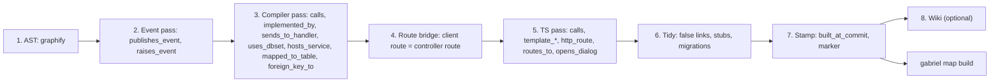

# Enhance your code graph

`/graphify` builds the code graph from the syntax tree (AST) of each file. That is fast and free, but it misses most links that cross a framework boundary. gabriel can only follow the links that the graph holds. This page shows how to add the missing links with your own passes, so that the map can answer "what handles this", "who calls this API" and "which table does this touch".

The reference build is Makillez (C# services and Angular web apps). Its tools are `technical-docs/for-dev/_tools/graph.py`, `roslyn-calls/` and `ts-calls/` in the Makillez docs repo. Copy the ideas, not the code: your frameworks decide which passes you need.

## 1. What the AST graph misses

| Link you want | Why the AST cannot see it | Pass that adds it |
|---|---|---|
| Message sender to its handler (MediatR `Send`, `Publish`) | The handler is found at run time from the message type. | Compiler pass (`sends_to_handler`, `publishes_to_handler`) |
| Event publisher to its subscriber (Dapr, a bus topic) | The link is a topic name in a string or an attribute. | Event pass (`publishes_event`, `handled_by`) |
| Domain event to its handler | The type is matched at run time. | Event pass (`raises_event`) |
| Interface method to its implementation | The AST sees the call to the interface only. | Compiler pass (`implemented_by`) |
| Repository to its entity (EF `DbSet`) | The entity is a generic type argument. | Compiler pass (`uses_dbset`) |
| Entity to its table, and to the entities its foreign keys point at | The table name and the keys are in EF configuration calls (`ToTable`, `HasOne(...).HasForeignKey(...)`). | Compiler pass (`mapped_to_table`, `foreign_key_to`) |
| Startup to a background service | `AddHostedService<T>()` names the type; the framework calls `ExecuteAsync`. | Compiler pass (`hosts_service`) |
| Frontend client to backend controller | The link is an HTTP verb and a URL string, often rewritten by a gateway. | Route bridge and TS pass (`http_route`) |
| Template to component and method | Angular templates are HTML, not code. | TS pass (`template_uses`, `template_calls`) |
| URL to the page that shows it | Routes are object literals passed to `RouterModule.forChild([...])`. | TS pass (`routes_to`, with `path` and `guards`) |
| Code to the dialog it opens | The component is an argument to `MatDialog.open(X)`, not a call. | TS pass (`opens_dialog`) |
| App to a shared library it imports from a build folder | The import resolves to `dist/*.d.ts`, which has no graph nodes. | TS pass (map the package name to the library source) |
| A correct call to an overload | The AST matches on the name, so an overload links to itself. | Tidy pass (removes the false links) |

Check your own repo first. List 5 to 10 real questions that the map answers badly today. Trace each one by hand. Each hop that the graph does not hold is a candidate pass.

## 2. The build order

Run the passes in this order. Each one reads the graph that the step before wrote.



In Makillez, `graph.py update` runs steps 1 to 7. It stops at the first failed step, and it writes the commit marker (`.last_update_commit`) last. A failed run leaves the old marker, so the next run tries again.

## 3. Rules for every pass

These rules keep a pass safe to run again and easy to roll back.

1. **Tag every link you add.** Set `_origin` to the pass name, for example `"_origin": "event-pass"`. AST links carry `"_origin": "ast"`.
2. **Remove your own links first.** At the start of a run, drop every link with your `_origin`, then add the new ones. A second run then gives the same file. Makillez checks this: two runs give the same SHA-256.
3. **Set the confidence.** Use `EXTRACTED` when a compiler or parser proved the link. Use `INFERRED` when you matched by name, topic or URL.
4. **Never delete nodes.** graphify refuses to write a graph with fewer nodes (the shrink guard). Remove or move links only. A pass may remove only the nodes it made itself (tag them with `_origin`).
5. **Reuse a node before you make one.** Search the graph for a node that already stands for the thing. In Makillez, the migration SQL scripts already gave 153 table nodes (`vess.Components`). `mapped_to_table` links to them and makes a new node only for the 6 tables with none.
6. **Print counts.** Print what you added, what you could not match and what was ambiguous. A drop between two runs is the first sign of a broken pass.
7. **Back up the graph first.** Copy `graph.json` and check the copy by SHA-256 before you write. Keep the graph folder in git, so `git checkout -- graphify-out/` rolls back.
8. **Read the code at one commit.** Run the passes on a clean worktree of the commit in `built_at_commit`, not on your working branch.

A link that a pass adds looks like this:

```json
{ "source": "<node id>", "target": "<node id>", "relation": "sends_to_handler",
  "confidence": "EXTRACTED", "_origin": "roslyn-pass",
  "source_file": "Services/X/X.Application/Commands/Foo.cs", "source_location": "L42" }
```

## 4. The passes in detail

### 4.1 Event pass (text scan, no compiler)

Use it for links that live in strings and attributes.

- Find the senders: lines that build a message, for example `new OrderCreated(...)` inside a publish call.
- Find the receivers: methods with a topic attribute (`[Topic("pubsub", "OrderCreated")]`) or a handler type (`INotificationHandler<OrderCreated>`).
- Join them on the message name. Add `publishes_event` (sender to receiver) for bus messages and `raises_event` for domain events.
- Keep the two kinds apart. In Makillez, a line that calls `PublishDomainEvent(new X(...))` raises a domain event, not a bus message. Mixing them gave 25 false bus links.
- Print the senders and receivers with no match. They are often real bugs: an event that nobody handles.

### 4.2 Compiler pass (Roslyn for C#)

Use the compiler when the link depends on types.

- `roslyn-calls/` is a small .NET console app. It opens each `.csproj`, builds the semantic model and writes an edges file: `calls`, `implemented_by`, `uses_dbset`, plus `sends_to_handler` and `publishes_to_handler` from the static type of the message in `Send(...)` and `Publish(...)`.
- It also reads three framework calls. `AddHostedService<T>()` gives `hosts_service` to the `ExecuteAsync` that `T` runs (own or inherited). `ToTable(name, schema)` gives `mapped_to_table`. `HasOne` / `HasMany` / `WithOwner` followed by `HasForeignKey(x => x.Id)` gives `foreign_key_to`, with `via` and the key name. Skip EF migrations: they repeat the model.
- `graph.py roslyn` reads that file and maps each symbol to a graph node by file and line.
- **Run `dotnet restore` on each project first.** Without it the compiler cannot load the packages. In Makillez a run without restore found 54 routes and no MediatR links. With restore it found 624 routes.
- Print the projects that failed to load and the calls it could not resolve (often generic types).

Other languages have the same kind of tool: the TypeScript compiler API, `go/types`, the Java compiler tree API, or an LSP server.

### 4.3 Route bridge and TS pass (frontend to backend)

- `ts-calls/` uses the TypeScript compiler API. It writes `calls`, template links, and one `client_route` item for each generated API client method: the HTTP verb and the path.
- It reads two client styles: NSwag `*Client` classes and OpenAPI generator `*.service.ts` classes. Look at your own generated clients and handle each style. In Makillez the second style added 102 routes.
- `graph.py bridge` joins client routes to controller routes on verb and path. It applies the gateway rewrite rules first (`envoy.yaml`), because the public path is not the controller path.
- `graph.py ts` adds the result as `http_route` (`INFERRED`), plus the TS links.
- Print the matched, ambiguous and unmatched routes.
- **Routes:** `ts-calls` walks each `RouterModule.forRoot/forChild([...])` array and adds `routes_to` (module to component or lazy module) with the full `path` and the inherited `canActivate` guards. Paths are often constants (`pages.afds.url`, `` `${pages.x.url}/:id` ``, `a + '/view'`). Resolve them by value, not by symbol: a constant typed by an interface points its symbols at the interface. In Makillez, 56 of 77 paths stayed unresolved until this was fixed.
- **Dialogs:** add `opens_dialog` only when the type checker says the receiver of `.open(X)` is `MatDialog` or `Dialog`. This needs the package types, so it needs `node_modules` (see Known traps).
- **Shared library from a build folder:** the Makillez apps import `common-lib` from `dist/`. Map the package name to the library source (`paths: { 'common-lib': ['<lib>/src/public-api.ts'] }`) for the app roots only. App calls then reach the library source: 592 new links.

### 4.4 Tidy pass

Clean the graph after all the passes have run.

- **Overload self-links.** Remove a `calls` link from a node to itself when the AST made it and the method has an overload. Keep real recursion.
- **Stub nodes.** graphify makes an empty node for a type it cannot place. Move each link from that empty node to the one real class with the same name in the same service. Skip the move when there is more than one candidate.
- **Noise tags.** Tag generated code that answers no question, for example EF migrations: `"migration": true`. gabriel gives these nodes no keywords and weak links.
- **Report count.** Correct the node and link count line in `GRAPH_REPORT.md`.

## 5. Check that the passes help

Do not trust a pass because it added links. Measure it.

1. **Coverage scorecard.** Write one row for each link family you expect, and count expected against found. Makillez uses `graph.py coverage`:

   | Row | Checks | Result (2026-11-19) |
   |---|---|---|
   | R1 | controller to handler | 99.8% |
   | R2 | client to controller | 100% |
   | R3 | template to child component | 97.0% |
   | R4 | repository to DbModel | 100% |
   | R5 | event to publisher | 100% |
   | R6 | methods with at least one link | 93.4% |

   No row may drop after a change. Pass the source folder (`src`), not the repo root: with the root, no path matches and the rows print 0% with no error.
   Also count the nodes that no link reaches. In Makillez, the route and dialog links took the components with no caller from 270 to 110.
2. **Spot checks.** Open 5 new links of each type in the code. Confirm that each one is real.
3. **gabriel eval.** Rebuild the map and run the eval before and after:
   ```
   node --max-old-space-size=4096 src/brain.js build-mk <name>
   node eval/eval-map.js --project <name>
   ```
   Add questions that need the new links (for example "what handles X") to a case file. Run it with `--cases <file> --fails --why`. In Makillez the passes on this page took a chain-question set from 35/73 to 38/73, with no drop on the main set (330/447).
4. **Try changes in a copy.** Copy `graph.json`, the pass script and gabriel to a temp folder. Point `GABRIEL_DATA` at a test data folder, so the real map is not touched. Apply a change to the real files only when the copy shows no drop.

## 6. Tell gabriel about the new link types

gabriel reads every link in `graph.json`, but it weights each link by its `relation`. The weights are in `REL` in `src/mk.js`. A relation that is not in `REL` gets 0.3.

- Give a new relation weight 1 when it is a real step in the code flow, for example `sends_to_handler`, `handled_by`, `http_route` or `uses_dbset`.
- Not in `REL` yet (so 0.3 today): `routes_to`, `opens_dialog`, `hosts_service`, `mapped_to_table`, `foreign_key_to`.
- Give it a lower weight when it only says that two nodes are related.
- Nodes with `"migration": true` get no keyword rows, and their links get 0.2 times the normal weight.
- Rebuild the map after a change to `REL` or to the graph.

## 7. Optional: a wiki with the flows

`graphify export wiki` writes one page per group (graphify "community"). It names each group after its most-linked node, and it does not show the links that your passes add. Makillez adds `graph.py wiki`:

1. It names each group after the service and folders that most of its nodes live in.
2. It runs `graphify export wiki`.
3. It adds a `## Flows` section to each group page, with lines like `` `X.Handle()` --sends_to_handler--> `YHandler.Handle()` ``.

## 8. Keep it current

After each code change that you want in the map:

1. Run the update (AST plus all passes). In Makillez: `graph.py update`, through a watched runner, about 4 minutes.
2. Read the counts of each pass. Compare them with the last run.
3. Run the coverage scorecard.
4. Rebuild the wiki, if you use it.
5. Rebuild the gabriel map. Check that `mk-status` says `ok` and shows the graph commit.

Do not run a plain `/graphify --update` on a graph that has passes. It re-extracts with the AST only, and the map loses the pass links until you run the passes again.

## 9. Known traps

| Trap | Effect | Fix |
|---|---|---|
| Compiler pass without `dotnet restore` | Most type links are missing, and the run still exits 0. | Restore each project first. Compare the counts with the last run. |
| A pass that does not remove its own links first | Each run adds duplicates. | Filter on `_origin` at the start. |
| Testing for a missing `_origin` to find AST links | AST links carry `"_origin": "ast"`, so the test matches nothing. | Test `e.get("_origin", "ast") == "ast"`. |
| Bus and domain events read as one kind | False bus links. | Split them on the publish call. |
| Deleting empty stub nodes | The shrink guard refuses the graph. | Keep the nodes, move the links. |
| One generated client style only | Many client calls get no route link. | Handle every client style in the repo. |
| TS pass in a fresh worktree | The worktree has no `node_modules`, so package types do not resolve. `opens_dialog` finds 0, and the run still exits 0. | Run the TS pass on a checkout with `node_modules` whose frontend folder equals the commit. Makillez `graph.py update` does this (`ts_source()`) and prints a WARNING when it cannot. Never link `node_modules` into the worktree: removing the worktree can delete the real folder. |
| A new pass makes its own node for a thing the graph already has | Two nodes for one table; a search finds half the links. | Reuse the existing node (rule 5). |
