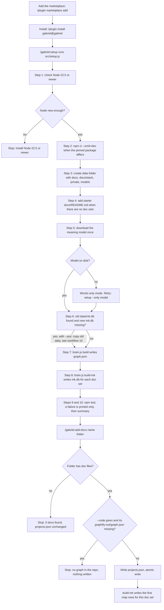
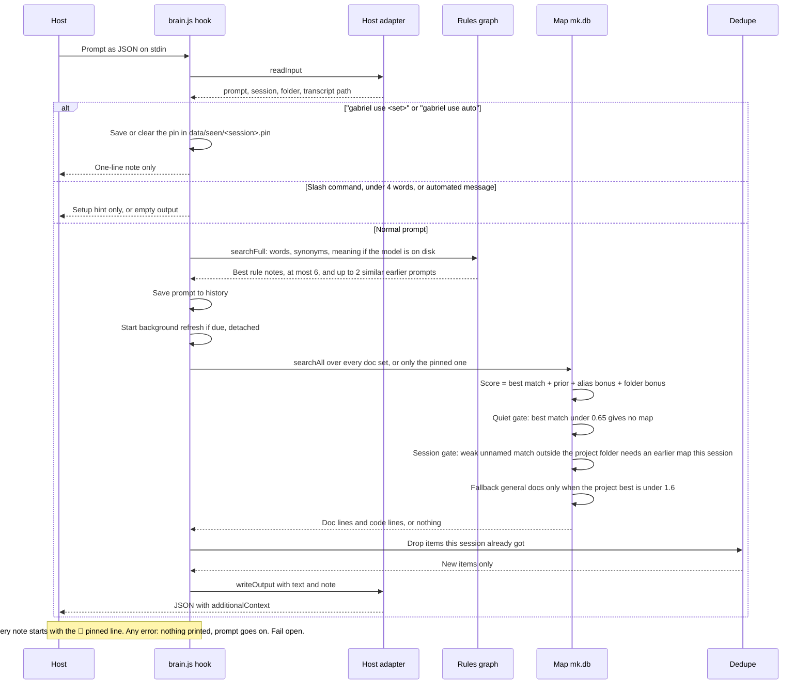
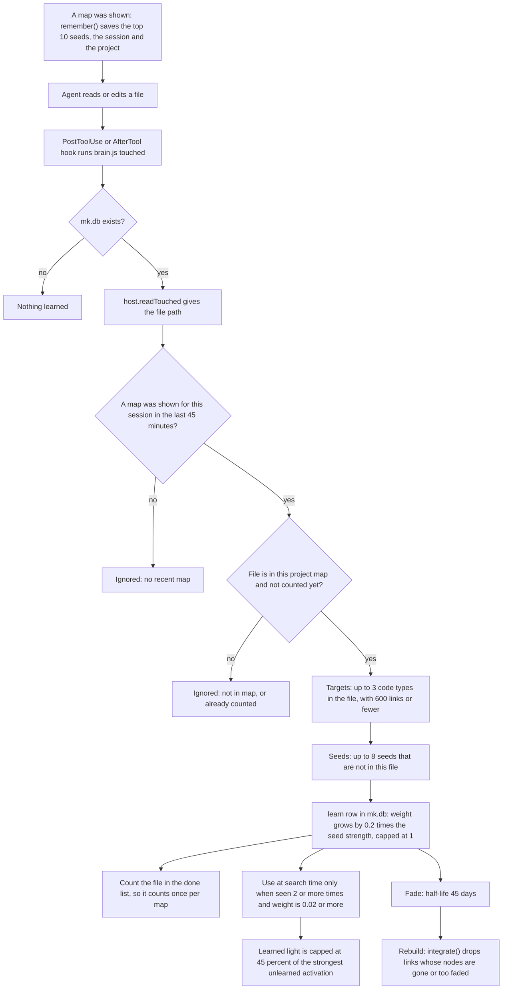
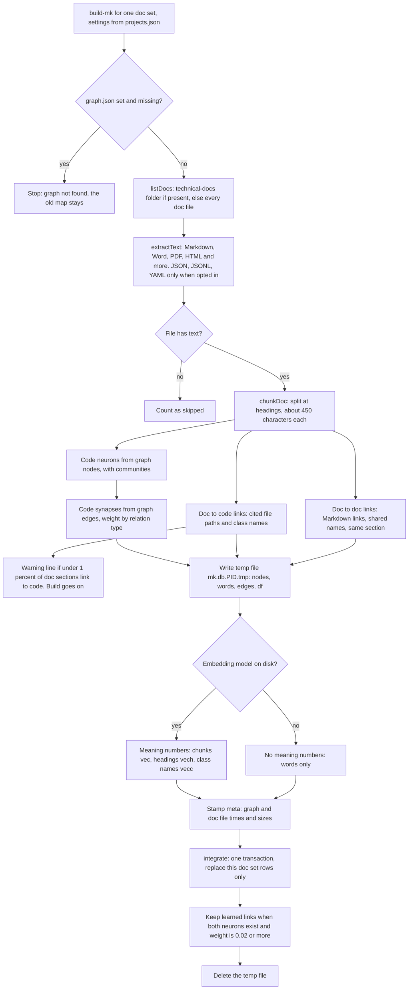
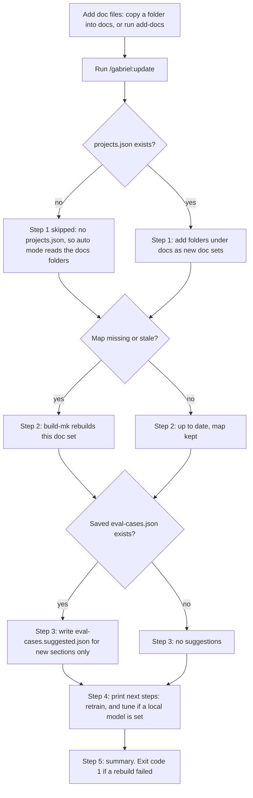
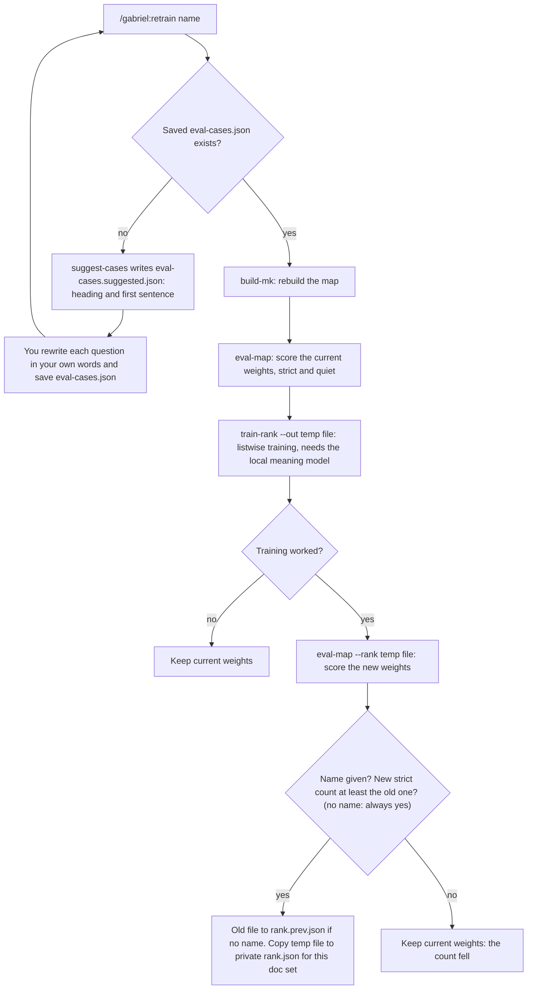
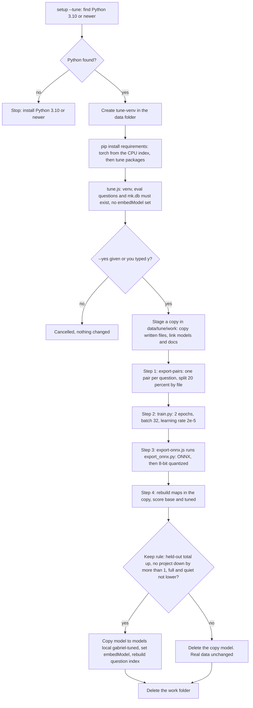
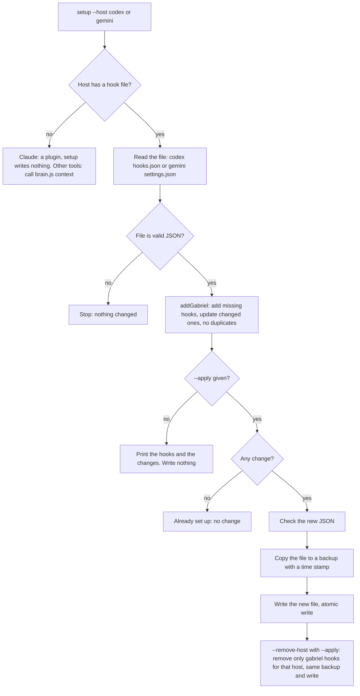
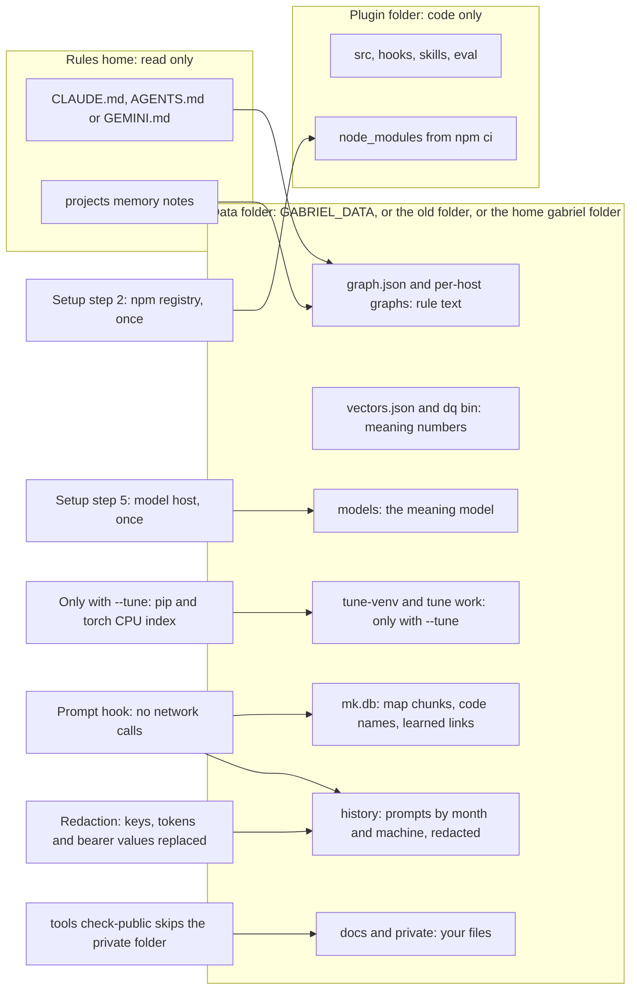
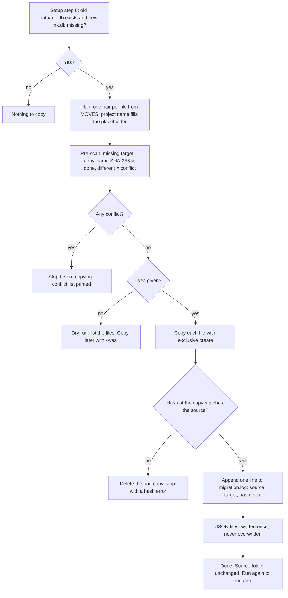

# Workflows

What gabriel does, step by step. Each section has a summary, the code to check, and one diagram that follows the code, not the plans.

Read [ARCHITECTURE.md](ARCHITECTURE.md) first for the parts.

Diamonds are decisions. Boxes with a file name are files gabriel reads or writes. "Fail open" means an error prints nothing and the prompt goes on. Terms (rules graph, map, meaning numbers): see [ARCHITECTURE](ARCHITECTURE.md).

## 1. Install and first setup

You add the plugin, install it, and run `/gabriel:setup`. Setup runs 10 steps. Then `add-docs` adds a doc set and builds its first map.

Code: `skills/setup/SKILL.md` runs `src/setup.js`. The 10 steps are in `run()` in `src/setup.js`. `skills/add-docs/SKILL.md` runs `addDocs()` in `src/setup.js`.

On a first install (or with `--onboard`), the setup skill then offers four optional steps, each asked first: install helper skills, graph a project, write its docs in the [DOC-LAYOUT](DOC-LAYOUT.md) layout, and download stack docs into `docs/stack/`. These run in Claude, not in `setup.js`.

## 2. One prompt

On each prompt, the host runs `brain.js hook`. Short prompts and slash commands get no context. Other prompts get rule notes, a map block, and similar earlier prompts. Items this session already got are removed.

Code: `hook()`, `gather()`, `dedupe()` and `searchFull()` in `src/brain.js`. `readInput` and `writeOutput` in `src/hosts/*.js`. `searchAll()`, `search()` and `format()` in `src/mk.js`.

## 3. Learning from use

When a map is shown, gabriel saves the prompt's strongest seeds for the session. If a file is read or edited soon after, gabriel links those seeds to the file's main types. Links fade and never start a search. Code: `remember()`, `touched()`, `learnShow()` and `learnReset()` in `src/mk.js`. `touchedHook()` in `src/brain.js`. `readTouched` in `src/hosts/*.js`. The hook matchers are in `hooks/hooks.json`.

## 4. Building a map

A build reads one doc set and its optional `graph.json`. It splits the docs into chunks and reads the code names. It writes a temp file, then copies only that doc set's rows into `mk.db`, in one transaction. The old map serves until then. Code: `build()`, `chunkDoc()` and `integrate()` in `src/mk.js`. `extractText()` in `src/extract.js`. `build-mk` mode in `src/brain.js`. The question index is built by `embedAll()` in `src/dq.js`.

## 5. Add docs later

You add or change doc files. Then you run `/gabriel:update`. It registers new folders, rebuilds stale maps, and suggests test questions for new sections. It never changes your saved questions. You often do not need to run it: the hook starts the same update in the background when it sees a new doc folder with files (`registerNewDocFolders()` in `src/brain.js`, at most once every 10 minutes). After code changes, `/gabriel:refresh-docs` updates the graph and the docs, then runs this update and asks whether to retrain. Code: `update()` in `src/setup.js`. `newSuggestions()` in `eval/suggest-cases.js`. `stale()` and `hasMap()` in `src/mk.js`.

## 6. Measure and retrain

Your saved questions show how well the map finds answers. `retrain` trains new ranking weights from them. With a doc set name, it keeps the new weights only when the strict pass count does not fall, unless you add `--force`. With no name (the default set), it always keeps them and saves the old file as `rank.prev.json`. Code: `eval/suggest-cases.js`, `eval/eval-map.js`, `src/train-rank.js` and `src/retrain.js`. The weights are read by `loadRank()` and used by `rankDocs()` in `src/mk.js`.

## 7. Fine-tune the meaning model (optional)

You train a copy of the meaning model on your own questions. Then you score the copy and the current model on a copy of your data. The copy becomes the meaning model only when the keep rule passes. `--rollback` removes the setting.

Code: `runTune()` in `src/setup.js`. `src/tune/tune.js` holds `stage()`, `measure()`, `decide()`, `keepModel()` and `rollBackModel()`. `src/tune/export-pairs.js`, `src/tune/train.py` and `src/tune/export_onnx.py` do the other steps.

## 8. Other agent hosts

Codex CLI and Gemini CLI get gabriel through their own hook file. `--host` shows the change. `--apply` writes it, after a backup. Other tools call `brain.js context`. Removing a host deletes only gabriel's hooks.

Code: `hostSetup()`, `addGabriel()` and `removeGabriel()` in `src/setup.js`. Host adapters in `src/hosts/codex.js`, `src/hosts/gemini.js`, `src/hosts/generic.js` and `src/hosts/claude.js`.

## 9. Data and privacy

Code lives in the plugin folder. Your docs, maps and prompt history live in one data folder. Setup downloads packages and one model, once. The prompt hook never downloads anything.

Code: `src/paths.js` (`dataDir()`, `rulesHome()`), `src/history.js` (`redact()`), `src/embed.js` (`getEmbedder()`, downloads off in the hook), `tools/check-public.js` (skips `private`).

## 10. Owner migration from the old brain folder

`migrate-data.js` copies data from the old brain folder into the data folder. It never deletes or changes the source. It hashes every file. A second run finishes what is left. Code: `migrate()` and `MOVES` in `src/migrate-data.js`. Step 6 in `run()` in `src/setup.js` plans the copy. It copies only with `--yes`.

