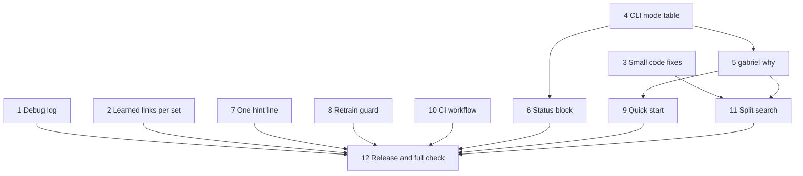
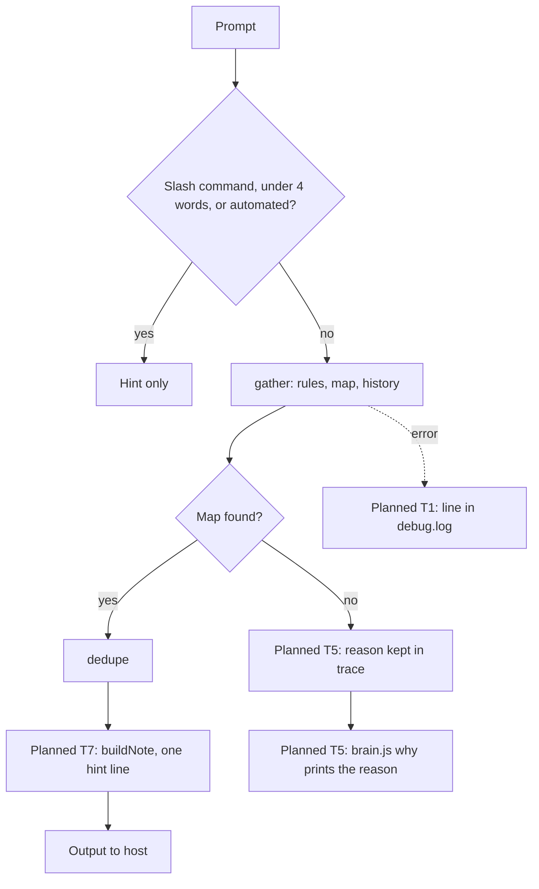
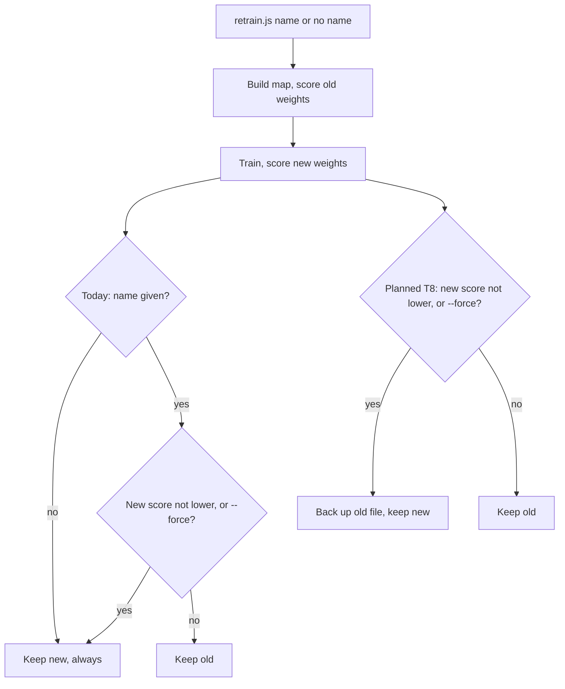

NaN/6 | 83% |NaN/7 | 100% |NaN/4 | 75% |NaN/4 | 100% |NaN/6 | 100% |NaN/6 | 100% |NaN/6 | 100% |NaN/8 | 100% |NaN/5 | 100% |NaN/5 | 100% |NaN/6 | 100% |NaN/6 | 100% |5/6 | 83% |7/7 | 100% |3/4 | 75% |4/4 | 100% |6/6 | 100% |6/6 | 100% |6/6 | 100% |8/8 | 100% |5/5 | 100% |5/5 | 100% |6/6 | 100% |6/6 | 100% |# Review Improvements Implementation Plan

> **For agentic workers:** REQUIRED SUB-SKILL: Use superpowers:subagent-driven-development (recommended) or superpowers:executing-plans to implement this plan task-by-task. Steps use checkbox (`- [ ]`) syntax for tracking.

**Goal:** Fix every finding of the 2026-11-14 review of gabriel: code, business workflow and UI/UX.

**Architecture:** Twelve small tasks, each with its own test. New code goes in small new files (`src/debuglog.js`, `src/statusview.js`). `src/brain.js` and `src/mk.js` change in place. The risky task (splitting `search()`) runs last, behind a before-and-after score check.

**Tech Stack:** Node.js 22.5 or newer, `node:sqlite`, `node:assert` tests run by `node test/run-all.js`, ESLint 9.

**Spec:** The "Findings" section of this file. There is no separate design doc. The review was done at commit `9bf8bf4` on branch `master`.

## Progress

Run on 2026-11-15, uncommitted, on top of `9bf8bf4`. Checks run: `npx eslint .` exit 0; `node test/run-all.js` 34/34 PASS, privacy 0 hits; handoff and full flow tests pass; eval output of the split `search()` equals the old code, byte for byte. Not run: Task 10 step 4 (the GitHub run needs a push); the graph rebuild of Task 12 step 5 (it needs a commit first).

| Task | Name | Steps done | % |
|---|---|---|---|
| 1 | Debug log | 6/6 | 100% |
| 2 | Learned links per doc set | 6/6 | 100% |
| 3 | Small code fixes | 5/5 | 100% |
| 4 | CLI mode table | 5/5 | 100% |
| 5 | `/gabriel:why` | 8/8 | 100% |
| 6 | Status block | 6/6 | 100% |
| 7 | One hint line per note | 6/6 | 100% |
| 8 | Same retrain guard for all runs | 6/6 | 100% |
| 9 | Quick start in the README | 4/4 | 100% |
| 10 | CI workflow | 3/4 | 75% |
| 11 | Split `search()` | 7/7 | 100% |
| 12 | Release 0.3.0 and full check | 5/6 | 83% |
| **All** | | **67/69** | **97%** |

## Global Constraints

- Never commit or push. The user does that. Each task ends with "stop for the user's commit".
- Node.js 22.5 or newer. No new packages.
- The hook must fail open: an error never blocks a prompt and never prints to stdout.
- Docs use short, common words and short sentences. Keep code names, paths and commands exact.
- `tools/check-public.js` (the privacy scan) must pass: no private names or paths in public files.
- Every ` ```mermaid ` block must parse (`test/test-mermaid.js`).
- Each test file sets `GABRIEL_DATA` to a temp folder and prints `ALL PASSED`. It never reads the real data folder.
- After each task: `npx eslint .` exits 0 and `node test/run-all.js` ends with `all checks passed`.
- After a code task, update the docs it touches in `docs/`, `repo-docs/` and `CHANGELOG.md` (under `## Unreleased`).

## Review Focus

Inputs no task's main test covers. Each has a test in the task named.

1. `GABRIEL_DEBUG=1` with a data folder that cannot be written: the hook still prints its normal output. (Task 1)
2. `learn-reset <name>` with a name that is not a doc set: nothing is deleted, exit code 1. (Task 2)
3. `why` on a prompt of 3 words or a slash command: it says the hook skips it, and runs no search. (Task 5)
4. A doc set with no map yet: the status block shows `no map` and its fix line, not `undefined`. (Task 6)
5. Retrain with no old score (first run, no `rank.json`): the new weights are kept, and no backup is tried. (Task 8)

## Findings (the spec)

Current behavior, read from the code at `9bf8bf4`.

| # | Area | Finding | Where | Task |
|---|---|---|---|---|
| F1 | Code | 91 `catch {` blocks, no debug log. A missing map leaves no trace. | `src/` | 1 |
| F2 | Code | `status()` counts learned links of all doc sets. | `src/mk.js:503` | 2 |
| F3 | Workflow | `learn-reset` deletes the learned links of every doc set. | `src/mk.js:491` | 2 |
| F4 | Code | The edge key `a * 1e6 + b` breaks above 1,000,000 nodes. | `src/mk.js:218`, `:223` | 3 |
| F5 | Code | A `DELETE` is prepared inside a loop. | `src/mk.js:408` | 3 |
| F6 | Code | `dbFile(home, project)` passes an argument that `dbFile` ignores. | `src/mk.js:46` and 6 callers | 3 |
| F7 | Code | The usage line omits `touched-files`, `build-dq` and `mk-status all`. The CLI is one `if/else` chain. | `src/brain.js:350-453` | 4 |
| F8 | UX | No user command explains a missing or wrong map. | `eval/eval-map.js --why` is a dev tool | 5 |
| F9 | UX | `mk-status all` prints one long line per doc set. | `src/brain.js:422` | 6 |
| F10 | UX | One note can hold a tip and the pin hint: two 💡 lines. | `src/brain.js:304-314` | 7 |
| F11 | UX | Two tips say `/gabriel:refresh-docs <code folder>`. The README leads with `<name>`. | `src/tips.js` tips 6 and 12 | 7 |
| F12 | Workflow | Retrain with no name always keeps the new weights. With a name it keeps them only if the score holds. | `src/retrain.js` `keepNew()` | 8 |
| F13 | Workflow | The README says setup takes an afternoon. It shows no short first path. | `README.md` | 9 |
| F14 | Code | No CI. | no `.github/` | 10 |
| F15 | Code | `search()` is one function of about 270 lines. | `src/mk.js:551-822` | 11 |
| F16 | Workflow | About 10 `Unreleased` entries sit on top of 0.2.0. | `CHANGELOG.md` | 12 |

**Assumptions and unknowns**

- Assumption: the tests pass on a clean GitHub runner with no meaning model. Not checked. Task 10 finds out.
- Assumption: `node eval/eval-map.js --project <name>` prints the same lines on two runs, apart from timing numbers. Task 11 step 1 checks this first.
- Unknown: the real hook time per prompt. Not measured in the review. Out of scope here.
- F12 reverses a choice in the `Unreleased` changelog ("no name: always replace, the owner's choice"). Drop Task 8 if that choice still stands.
- `test/test-tune.js` takes about 70 s. Speeding it up is out of scope.

## Diagrams

Planned work and its order. A node is a task number.



One prompt, today and planned. Planned parts name their task.



Retrain, today and planned.



---

### Task 1: Debug log

**Depends on:** nothing. **Runs alone:** yes. **Input:** env `GABRIEL_DEBUG`. **Output:** `<data>/debug.log`.

**Files:**
- Create: `src/debuglog.js`
- Create: `test/test-debuglog.js`
- Modify: `src/brain.js` (the `catch` blocks of `mapFor`, `touchedHook`, `refreshMapInBackground`, `searchFull`, `hook`)
- Modify: `src/mk.js` (the outer `catch` of `search()` at line 821, the `catch` of `touched()` at line 478)
- Modify: `docs/TROUBLESHOOTING.md` (section "Still stuck"), `docs/PRIVACY.md`

**Interfaces:**
- Produces: `debug(where: string, err: unknown): void` from `src/debuglog.js`. It never throws. It does nothing unless `process.env.GABRIEL_DEBUG === '1'`.

- [ ] **Step 1: Write the failing test** `test/test-debuglog.js`

```js
'use strict';
const assert = require('node:assert');
const fs = require('node:fs');
const os = require('node:os');
const path = require('node:path');
const DATA = fs.mkdtempSync(path.join(os.tmpdir(), 'dbg-test-'));
process.env.GABRIEL_DATA = DATA;
delete process.env.BRAIN_DATA;
const { debug } = require('../src/debuglog.js');
const file = path.join(DATA, 'debug.log');
try {
  delete process.env.GABRIEL_DEBUG;
  debug('mapFor', new Error('boom'));
  assert.strictEqual(fs.existsSync(file), false, 'off by default: no file');
  process.env.GABRIEL_DEBUG = '1';
  debug('mapFor', new Error('boom'));
  const line = fs.readFileSync(file, 'utf8');
  assert.match(line, /^\d{4}-\d\d-\d\dT[\d:.]+Z mapFor: boom\n$/);
  fs.writeFileSync(file, 'x'.repeat(1024 * 1024 + 1));
  debug('hook', 'plain text');
  assert.ok(fs.statSync(file).size < 1000, 'over 1 MB: the file starts again');
  process.env.GABRIEL_DATA = path.join(DATA, 'missing', '\0bad');
  assert.doesNotThrow(() => debug('hook', new Error('x')), 'a folder that cannot be written never throws');
  console.log('ALL PASSED');
} finally { fs.rmSync(DATA, { recursive: true, force: true }); }
```

- [ ] **Step 2: Run it.** `node test/test-debuglog.js`. Expected: FAIL, `Cannot find module '../src/debuglog.js'`.
- [ ] **Step 3: Write `src/debuglog.js`.** One function. It reads `paths.dataDir()` on each call (the test changes the env). Line format: `<ISO time> <where>: <err.message or String(err)>\n`. Before the write, if the file is over 1 MB (1024 * 1024 bytes), truncate it. Never log prompt text.
- [ ] **Step 4: Call `debug('<function name>', e)`** in the 7 `catch` blocks listed under Files. Change `catch {` to `catch (e) {` there only. Leave the other 84 alone: they guard optional parts.
- [ ] **Step 5: Docs.** In `docs/TROUBLESHOOTING.md` "Still stuck", add: set `GABRIEL_DEBUG=1`, ask again, read `<data>/debug.log`. In `docs/PRIVACY.md`, add the file: it holds error text, no prompts, and stays under 1 MB.
- [ ] **Step 6: Run** `node test/test-debuglog.js` (expected `ALL PASSED`), then `npx eslint .` and `node test/run-all.js` (expected `all checks passed`). Stop for the user's commit.

**Acceptance test:** with `GABRIEL_DEBUG=1` and `mk.db` replaced by a text file, one prompt through `node src/brain.js hook` prints valid host output and adds one line to `debug.log`.

---

### Task 2: Learned links per doc set

**Depends on:** nothing. **Runs alone:** yes. **Input:** a doc set name. **Output:** a count, or a scoped delete.

**Files:**
- Modify: `src/mk.js` (`status()` line 503, `learnReset()` line 491, `module.exports`)
- Modify: `src/brain.js` (`learn-reset` mode, line 408)
- Modify: `test/test-map.js` (the "learning from use" part, near line 166)
- Modify: `docs/ARCHITECTURE.md:130`, `docs/PRIVACY.md:96`, `repo-docs/business/03-state-machines.md:62`, `repo-docs/business/workflows/W05-learning-from-use.md:21` and `:54`, `repo-docs/technical/03-dev-workflow.md:75`

**Interfaces:**
- Produces: `learnReset(home: string, project?: string): number`. With no project it deletes all rows (as today). With a project it deletes only that set's rows. It returns the number of `learn` rows deleted.
- Produces: `status()` field `learned`: the count for that project only.

A link belongs to a set when its `ka` is a key of that set's nodes. Use this, because old files have no `project` column on `learn`:

```sql
SELECT COUNT(*) AS c FROM learn WHERE ka IN (SELECT key FROM nodes WHERE project = ?)
```

- [ ] **Step 1: Write the failing test** in `test/test-map.js`, after the existing learning asserts (alpha has learned links there, beta has none):

```js
assert.ok(mk.status(home, 'alpha').learned > 0, 'alpha counts its own learned links');
assert.strictEqual(mk.status(home, 'beta').learned, 0, 'beta has none: the count is per doc set');
assert.strictEqual(mk.learnReset(home, 'beta'), 0, 'a reset of beta deletes nothing of alpha');
assert.ok(mk.status(home, 'alpha').learned > 0);
assert.ok(mk.learnReset(home, 'alpha') > 0, 'a reset of alpha deletes its links');
assert.strictEqual(mk.status(home, 'alpha').learned, 0);
```

Place it at the end of the learning part, so later asserts do not need the links.

- [ ] **Step 2: Run** `node test/test-map.js`. Expected: FAIL on `beta has none`.
- [ ] **Step 3: Change `status()` and `learnReset()`.** For a project reset, delete `learn` rows with the query above (use `DELETE`), and `last` rows with `DELETE FROM last WHERE project = ?` (`openRw` adds that column).
- [ ] **Step 4: Change the `learn-reset` mode** to `learn-reset [name]`. An unknown name prints `unknown doc set: <name>`, deletes nothing and sets `process.exitCode = 1`. Add to the test: run it as a child process with name `nope`, assert status 1 and that alpha's count did not change. Put this assert before the alpha reset.
- [ ] **Step 5: Docs.** Say `learn-reset [name]` in the six doc lines under Files.
- [ ] **Step 6: Run** `node test/test-map.js`, `npx eslint .`, `node test/run-all.js`. Expected: all pass. Stop for the user's commit.

**Acceptance test:** `node src/brain.js learn-reset <one set>` then `node src/brain.js learn-show` still lists the other sets' links.

---

### Task 3: Small code fixes

**Depends on:** nothing. **Runs alone:** yes. **Input:** none. **Output:** same behavior.

**Files:**
- Modify: `src/mk.js:218`, `:223`, `:408`, and each `dbFile(home, project)` call (lines 178, 180, 500, 526, 538, 554)

No new test: these keep behavior. The check is the existing `test/test-map.js`, `test/test-graph.js` and `test/test-plain-docs.js`.

- [ ] **Step 1: Edge key.** Replace `1e6` with `const M = g.nodes.length + 1;` declared before the loop at line 214. Use `a * M + b`, `Math.floor(k / M)` and `k % M`. This is safe while `M * M < 2^53` (about 94 million nodes).
- [ ] **Step 2: Hoist the `DELETE`.** Prepare `DELETE FROM learn WHERE ka = ? AND kb = ?` once, before the loop at line 408.
- [ ] **Step 3: Drop the unused argument.** Change every `dbFile(home, project)` to `dbFile(home)`.
- [ ] **Step 4: Run** `node test/test-map.js`, `node test/test-graph.js`, `node test/test-plain-docs.js`. Expected: `ALL PASSED` each.
- [ ] **Step 5: Run** `npx eslint .` and `node test/run-all.js`. Stop for the user's commit.

**Acceptance test:** `git diff --stat` shows only `src/mk.js`; all tests pass.

---

### Task 4: CLI mode table

**Depends on:** nothing. **Runs alone:** yes. **Input:** `process.argv`. **Output:** the same modes, and a usage text that cannot go stale.

**Files:**
- Modify: `src/brain.js:344-455`
- Modify: `test/test-brain.js`

**Interfaces:**
- Produces: `MODES`, an object in `src/brain.js`: `{ [name: string]: { args: string, run: (ctx) => Promise<void> | void } }`. `ctx` is `{ arg, host, home, argv }`. Exported as `module.exports.MODES`.
- Produces: `usage(): string`: `'usage: node brain.js ' + ` each mode as `name args`, joined with ` | `.
- Tasks 5 and 6 add or change entries in `MODES`.

- [ ] **Step 1: Write the failing test** in `test/test-brain.js`:

```js
const { MODES } = require('../src/brain.js');
for (const m of ['build', 'query', 'hook', 'touched', 'touched-files', 'context', 'refresh', 'graph', 'related', 'check', 'build-dq', 'build-mk', 'learn-show', 'learn-reset', 'mk-status', 'mk', 'forget'])
  assert.strictEqual(typeof MODES[m].run, 'function', 'mode ' + m);
const out = require('node:child_process').spawnSync(process.execPath, [path.join(__dirname, '..', 'src', 'brain.js'), 'nonsense'], { encoding: 'utf8' }).stdout;
for (const m of Object.keys(MODES)) assert.ok(out.includes(m), 'usage names ' + m);
```

- [ ] **Step 2: Run** `node test/test-brain.js`. Expected: FAIL, `MODES` is undefined.
- [ ] **Step 3: Move each `else if` body** into `MODES[name].run`, with no change to the body. `mk-status` keeps one entry and branches on `arg === 'all'` inside. The main block becomes: find the mode, run it, else print `usage()`.
- [ ] **Step 4: Run** `node test/test-brain.js`. Expected: `ALL PASSED`.
- [ ] **Step 5: Run** `npx eslint .` and `node test/run-all.js`. Stop for the user's commit.

**Acceptance test:** `node src/brain.js mk-status all` prints the same text as before the task (compare with a saved copy).

---

### Task 5: `/gabriel:why`

**Depends on:** Task 4 (`MODES`). **Runs alone:** no. **Input:** a prompt. **Output:** one reason line per doc set.

**Files:**
- Modify: `src/mk.js` (`search()` and `searchAll()`: fill `opts.trace`)
- Modify: `src/brain.js` (new `skipReason()`, used by `hook()` line 299 and `contextText()` line 321; new `why` mode)
- Create: `skills/why/SKILL.md`
- Modify: `test/test-map.js`, `test/test-brain.js`
- Modify: `README.md` (both skill tables), `docs/TROUBLESHOOTING.md` (section "No map is shown for a prompt")

**Interfaces:**
- Produces: `opts.trace` in `mk.search()`. When the caller passes an object, `search()` sets `trace.reason` and `trace.best` (a number, 0 when not known). Values of `reason`:

| `reason` | Set where today's code returns |
|---|---|
| `no-map-file` | the `catch` after opening the db (line 554) |
| `old-version` | `meta.version !== DB_VERSION` (line 557) |
| `no-words` | `!q.size` (line 559) |
| `no-seeds` | `!seeds.size` (line 628) |
| `below-gate` | `best < gate` (line 631) |
| `nothing-to-show` | `!docs.length && !code.length` (line 787) |
| `error` | the outer `catch` (line 821) |
| `shown` | the normal return (line 820) |

- Produces: `searchAll()` sets `opts.trace.sets = { [project]: { reason, best } }` and `opts.trace.sessionGate = true` when line 855 clears the hits. It passes a fresh trace object to each `search()` call.
- Produces: `skipReason(prompt: string): '' | 'slash command' | 'under 4 words' | 'automated prompt'` in `src/brain.js`, exported.
- Produces: mode `why`, args `"<prompt>" [--session <id>]`.

Exact output lines of `why`:

```
gabriel skips this prompt: <skipReason>. No search runs.
<label>: shown (best <n.nn>)
<label>: no map, best match <n.nn> is under the gate 0.65
<label>: no map, no word of this prompt is in these docs
<label>: no map file yet. Run /gabriel:setup
<label>: map format is old. Run /gabriel:update
<label>: no map, an error stopped the search. Set GABRIEL_DEBUG=1 and read debug.log
pinned: <name>. Only that doc set is searched. Type "gabriel use auto" to undo.
session gate: a weak match, and this session had no map of <label> yet.
```

`no-seeds` and `no-words` both print the "no word of this prompt" line. `nothing-to-show` prints the "under the gate" line.

- [ ] **Step 1: Write the failing trace test** in `test/test-map.js`:

```js
{ const t = {}; assert.strictEqual(mk.search(home, 'zzzz qqqq xxxx wwww', { project: 'alpha', trace: t }), null); assert.strictEqual(t.reason, 'no-seeds'); }
{ const t = {}; assert.ok(mk.search(home, Q, { project: 'alpha', trace: t })); assert.strictEqual(t.reason, 'shown'); assert.ok(t.best > 0); }
{ const t = {}; mk.searchAll(home, Q, { trace: t }); assert.strictEqual(t.sets.alpha.reason, 'shown'); assert.ok('beta' in t.sets); }
```

`Q` is the question the file already uses for alpha.

- [ ] **Step 2: Run** `node test/test-map.js`. Expected: FAIL on `t.reason`.
- [ ] **Step 3: Fill the trace** in `search()` and `searchAll()`. With no `opts.trace`, nothing changes.
- [ ] **Step 4: Write the failing `skipReason` test** in `test/test-brain.js`:

```js
const { skipReason } = require('../src/brain.js');
assert.strictEqual(skipReason('/gabriel:status'), 'slash command');
assert.strictEqual(skipReason('fix this bug'), 'under 4 words');
assert.strictEqual(skipReason('how does the map search work'), '');
```

Then run a child process: `node src/brain.js why "fix this bug"`. Assert stdout is exactly `gabriel skips this prompt: under 4 words. No search runs.\n`.

- [ ] **Step 5: Write `skipReason()`** from the condition at `src/brain.js:299`, and use it in `hook()` and `contextText()`. Add the `why` mode: print the skip line, or embed the prompt (as the `mk` mode does), call `searchAll` with a trace and the session's pin, and print one line per set.
- [ ] **Step 6: Write `skills/why/SKILL.md`.** Copy the front matter style of `skills/status/SKILL.md`. Name `why`, `disable-model-invocation: true`, `argument-hint: "<prompt>"`. Body: run `node "${CLAUDE_PLUGIN_ROOT}/src/brain.js" why "$ARGUMENTS"`, show the lines as they are, and name the next step each line gives.
- [ ] **Step 7: Docs.** Add `/gabriel:why "<prompt>"` to both README tables ("I want to know why I got no map"). Add it as step 1 of "No map is shown for a prompt" in `docs/TROUBLESHOOTING.md`.
- [ ] **Step 8: Run** `node test/test-map.js`, `node test/test-brain.js`, `npx eslint .`, `node test/run-all.js`. Stop for the user's commit.

**Acceptance test:** `node src/brain.js why "how does the pin command pick a doc set"` prints one line per doc set in `projects.json`, and the set marked `shown` is the set the hook's map names for the same prompt.

---

### Task 6: Status block

**Depends on:** Task 4 (`MODES`). **Runs alone:** no. **Input:** `mk.status()` per set. **Output:** a short block per doc set.

**Files:**
- Create: `src/statusview.js`
- Create: `test/test-statusview.js`
- Modify: `src/brain.js` (`mk-status` mode, the `all` branch, today at line 420-425)
- Modify: `skills/status/SKILL.md`, `skills/refresh-docs/SKILL.md:9` and `:23` ("that set's line" becomes "that set's block")
- Modify: any test that matches the old one-line text (find with `grep -n "neurons, built" test/*.js`)

**Interfaces:**
- Produces: `statusBlock(v): string[]` from `src/statusview.js`, where `v = { label, name, s, graphPath, graphExists, repo, repoExists, fix }`. `s` is the object `mk.status()` returns. `fix` is a string or null (from the existing `fixFor`).

Exact layout. The state word is one of `ok`, `STALE`, `no map`, `GRAPH MISSING`, `REPO MISSING` (first that applies, in the order `GRAPH MISSING`, `no map`, `STALE`, `REPO MISSING`, `ok`):

```
Alpha  ok
  map    12 code + 34 doc neurons, built 2026-11-14 09:12, @f59545cd
  graph  /x/graphify-out/graph.json
  repo   /x/code
```

Rules: the `map` line is left out when `s.nDoc` is falsy. `, @<8 chars>` is left out with no `mapCommit`. The `graph` line is left out with no `graphPath`; it ends with `   GRAPH MISSING` when the file is gone. The `repo` line is left out with no `repo` and no `graphPath`; with a graph but no repo it is `  repo   none (add-docs <name> --repo <folder> --relink)`; it ends with `   REPO MISSING` when the folder is gone. The last line is `  fix: <fix>` when `fix` is set.

- [ ] **Step 1: Write the failing test** `test/test-statusview.js`:

```js
'use strict';
const assert = require('node:assert');
const { statusBlock } = require('../src/statusview.js');
const built = Date.UTC(2026, 10, 14, 9, 12);
assert.deepStrictEqual(statusBlock({ label: 'Alpha', name: 'alpha', s: { nCode: 12, nDoc: 34, built, mapCommit: 'f59545cd1234', stale: false }, graphPath: '/x/graphify-out/graph.json', graphExists: true, repo: '/x/code', repoExists: true, fix: null }), [
  'Alpha  ok',
  '  map    12 code + 34 doc neurons, built 2026-11-14 09:12, @f59545cd',
  '  graph  /x/graphify-out/graph.json',
  '  repo   /x/code',
]);
assert.deepStrictEqual(statusBlock({ label: 'Notes', name: 'notes', s: { stale: false }, graphPath: null, graphExists: false, repo: null, repoExists: false, fix: 'node src/brain.js build-mk notes' }), [
  'Notes  no map',
  '  fix: node src/brain.js build-mk notes',
]);
const gone = statusBlock({ label: 'B', name: 'b', s: { nCode: 1, nDoc: 2, built, stale: true }, graphPath: '/g.json', graphExists: false, repo: null, repoExists: false, fix: 'x' });
assert.strictEqual(gone[0], 'B  GRAPH MISSING');
assert.ok(gone.includes('  graph  /g.json   GRAPH MISSING'));
assert.ok(gone.includes('  repo   none (add-docs b --repo <folder> --relink)'));
assert.ok(!gone.join('\n').includes('undefined'));
console.log('ALL PASSED');
```

- [ ] **Step 2: Run** `node test/test-statusview.js`. Expected: FAIL, module not found.
- [ ] **Step 3: Write `src/statusview.js`** and call it from the `all` branch: one `console.log` per line, and one empty line between sets.
- [ ] **Step 4: Update the old-text tests** found by the grep, and the two skills. The words `STALE`, `ok`, `GRAPH MISSING`, `REPO MISSING`, `graph <path>`, `@<commit>` and `fix:` all stay, so the skills only change "line" to "block".
- [ ] **Step 5: Docs.** Update the sample output, if any, in `docs/TROUBLESHOOTING.md` lines 155-176 and `repo-docs/business/03-state-machines.md:11-14`.
- [ ] **Step 6: Run** `node test/test-statusview.js`, `npx eslint .`, `node test/run-all.js`. Stop for the user's commit.

**Acceptance test:** `node src/brain.js mk-status all` shows no line over 120 characters, apart from long paths.

---

### Task 7: One hint line per note

**Depends on:** nothing. **Runs alone:** yes. **Input:** the parts of a note. **Output:** one note string.

**Files:**
- Modify: `src/brain.js` (`hook()`, lines 303-314)
- Modify: `src/tips.js` (tips 6 and 12)
- Modify: `test/test-brain.js`, `test/test-tips.js` only if it matches tip text

**Interfaces:**
- Produces: `buildNote({ view, skipped, hint, pinned, manySets }): string`, exported from `src/brain.js`. `view` is the `humanize()` text or `''`. `skipped` is a number. `hint` is the setup hint or tip, or `''`. `pinned` is a set name or null. `manySets` is a boolean.

Line order: the pinned line, the view, the skipped line, then **one** 💡 line at most. The setup hint or tip wins. The pin hint shows only when there is no hint, no pin, `manySets` is true and `view` is not empty. Exact strings stay as they are today in `hook()`.

- [ ] **Step 1: Write the failing test** in `test/test-brain.js`:

```js
const { buildNote } = require('../src/brain.js');
const PIN_HINT = '💡 Working in one project? Type "gabriel use <set>" to search only that doc set this session.';
const both = buildNote({ view: '🧭 A map', skipped: 0, hint: '💡 Tip: x', pinned: null, manySets: true });
assert.strictEqual((both.match(/💡/g) || []).length, 1, 'one hint line at most');
assert.ok(both.includes('💡 Tip: x'), 'the tip wins');
assert.ok(buildNote({ view: '🧭 A map', skipped: 0, hint: '', pinned: null, manySets: true }).endsWith(PIN_HINT));
assert.ok(!buildNote({ view: '🧭 A map', skipped: 0, hint: '', pinned: 'alpha', manySets: true }).includes('💡'));
assert.ok(buildNote({ view: '', skipped: 2, hint: '', pinned: null, manySets: true }).includes('(2 items already in context, not repeated)'));
assert.strictEqual(buildNote({ view: '', skipped: 0, hint: '', pinned: null, manySets: false }), '');
```

- [ ] **Step 2: Run** `node test/test-brain.js`. Expected: FAIL, `buildNote` is not a function.
- [ ] **Step 3: Write `buildNote()`** and use it for both `writeOutput` calls in `hook()` that build a note from a view, a skipped count and a hint (lines 305-308 and 312-314). The `🧭 Brain: ` prefix of the no-context case stays.
- [ ] **Step 4: Tips.** In `src/tips.js`, change `/gabriel:refresh-docs <code folder>` to `/gabriel:refresh-docs <name>` in tips 6 and 12.
- [ ] **Step 5: Run** `node test/test-brain.js`, `node test/test-tips.js`, `node test/test-hook-fresh.js`. Expected: `ALL PASSED` each.
- [ ] **Step 6: Run** `npx eslint .` and `node test/run-all.js`. Add a `CHANGELOG.md` line. Stop for the user's commit.

**Acceptance test:** in a new session with two doc sets, the first map note has one 💡 line.

---

### Task 8: Same retrain guard for all runs

**Depends on:** nothing. **Runs alone:** yes. **Reverses an earlier choice: see Assumptions.** **Input:** old and new strict counts. **Output:** keep or drop the new weights.

**Files:**
- Modify: `src/retrain.js` (`keepNew()`, the header comment, the keep branch)
- Modify: `test/test-train.js:111-116`
- Modify: `skills/retrain/SKILL.md`, `README.md` (the `/gabriel:retrain` text and table row), `docs/EVAL.md`, `repo-docs/business/workflows/W06-eval-and-retrain.md`, `repo-docs/business/02-business-rules.md`, `CHANGELOG.md`

**Interfaces:**
- Produces: `keepNew(oldS, newS, force = false): boolean`. True when `force`, or when there is no old count (`!oldS`) and there is a new one, or when `newS.n >= oldS.n`. The `named` parameter is gone.

Behavior: a run with no name retrains the default doc set, under the same guard. When an existing rank file is replaced, it is always copied to `rank.prev.json` first.

- [ ] **Step 1: Replace the asserts** at `test/test-train.js:112-116`:

```js
assert.strictEqual(keepNew({ n: 5 }, { n: 4 }), false, 'a lower strict count keeps the old weights');
assert.strictEqual(keepNew({ n: 5 }, { n: 5 }), true, 'an equal count keeps the new weights');
assert.strictEqual(keepNew({ n: 5 }, { n: 4 }, true), true, '--force keeps the new weights');
assert.strictEqual(keepNew(null, { n: 4 }), true, 'first run, no old score: keep the new weights');
assert.strictEqual(keepNew({ n: 5 }, null), false, 'no new score: keep the old weights');
```

- [ ] **Step 2: Run** `node test/test-train.js`. Expected: FAIL on the first assert.
- [ ] **Step 3: Change `keepNew()` and its one caller.** Back up whenever `fs.existsSync(P.rank)` is true before the copy. Remove the `no name given: always replaced` text. Keep the `--force: kept the new weights although strict fell` line for any forced run that fell.
- [ ] **Step 4: Run** `node test/test-train.js`. Expected: `ALL PASSED`.
- [ ] **Step 5: Docs.** In each file under Files, replace "with no name it always keeps" with: "No name means the default doc set. The new ranking is kept only if it scores at least as well. `--force` keeps it anyway. The old file is saved as `rank.prev.json`."
- [ ] **Step 6: Run** `npx eslint .` and `node test/run-all.js`. Stop for the user's commit.

**Acceptance test:** `node src/retrain.js` (no name) on a set where the new strict count is lower prints `kept the current weights: the new strict count is lower (...)`.

---

### Task 9: Quick start in the README

**Depends on:** Task 5 (it names `/gabriel:why`). **Runs alone:** no. **Input:** none. **Output:** docs only.

**Files:**
- Modify: `README.md` (new section after the three intro bullets, before the warning; the warning text)

- [ ] **Step 1: Add `## Quick start (5 minutes)`** with these four steps and nothing more:
  1. `/plugin marketplace add <git url or local folder>` and `/plugin install gabriel@gabriel`.
  2. `/gabriel:setup`. Say no to the optional steps for now.
  3. `/gabriel:add-docs <name> <a folder of docs you already have>`.
  4. Ask a question about those docs. No map? Run `/gabriel:why "<your question>"`.
- [ ] **Step 2: Reword the warning** to: "**The full setup is big.** The quick start above takes minutes and works on docs you already have. The best results need more: a code graph and docs about your code. Plan an afternoon for that. See [Pros and cons](#pros-and-cons)."
- [ ] **Step 3: Check the claim.** In a temp data folder (`--data <temp dir>`), run step 3 on this repo's `docs/` folder and step 4 with `node src/brain.js context "how do I add a doc set to gabriel"`. Expected: a map block that names `ADDING-DOCS.md`. If it shows nothing, fix the quick start text, not the code.
- [ ] **Step 4: Run** `node test/run-all.js` (the doc and privacy checks run there). Stop for the user's commit.

**Acceptance test:** a reader can go from install to a first map with the four steps alone.

---

### Task 10: CI workflow

**Depends on:** nothing. **Runs alone:** yes. **Input:** a push or pull request. **Output:** a pass or fail on GitHub.

**Files:**
- Create: `.github/workflows/test.yml`

- [ ] **Step 1: Write the workflow.** Name `test`. Triggers: `push` to `master`, and `pull_request`. One job on `windows-latest` and `ubuntu-latest` (a matrix), Node `22.x`. Steps: `actions/checkout@v4`, `actions/setup-node@v4` with `cache: npm`, `npm ci`, `npm run lint`, `npm test`. `permissions: contents: read`. `timeout-minutes: 15`.
- [ ] **Step 2: Check it locally for the no-model case.** Run `node test/run-all.js` with `private/models` renamed for the run, then rename it back. Expected: `all checks passed`. If a test needs the model, make that test print a skip line and exit 0 when the model is missing, the way `test/test-mermaid.js` does for its packages.
- [ ] **Step 3: Docs.** One line in `repo-docs/technical/03-dev-workflow.md`: CI runs lint and tests on each push.
- [ ] **Step 4: Stop for the user's commit and push.** The first run on GitHub is the real check. Record its result in the Progress table.

**Acceptance test:** the GitHub run is green on both systems.

---

### Task 11: Split `search()`

**Depends on:** Tasks 3 and 5 (both edit `search()`). **Runs alone:** no. **Input:** none. **Output:** the same results, in smaller functions.

**Files:**
- Modify: `src/mk.js:551-822`

This task changes no behavior. `search()` keeps its name, its parameters and its return value. Its body becomes calls to inner functions in the same file, in this order. Each takes a shared state object `S` (the db, `project`, `opts`, `meta`, and the maps built so far) and returns nothing or `null` to stop.

| New function | Today's lines | Job |
|---|---|---|
| `seedByWords(S)` | 561-585 | word and heading scores, the seeds |
| `seedByMeaning(S)` | 586-627 | meaning, heading meaning and question index seeds |
| `gateAndNormalize(S)` | 628-641 | the gate, `act`, `seedKeys` |
| `loadLearned(S)` | 642-654 | learned links |
| `spread(S)` | 655-676 | the spreading rounds |
| `pickResults(S)` | 677-699 | first lists of docs and code |
| `addNamedCode(S)` | 700-743 | the code-name pass and class-name meaning |
| `rankDocRows(S)` | 744-786 | the trained doc ranking |
| `addNeighbours(S)` | 788-812 | one-hop and two-hop code |
| `addExactLines(S)` | 813-817 | lines from the repo folder |

- [ ] **Step 1: Save the baseline.** For each doc set with eval cases, run `node eval/eval-map.js --project <name>` twice and save both outputs in the scratch folder. Remove timing numbers (`\d+ ms`) from both. Expected: the two files are equal. If not, find what differs and remove that too before going on.
- [ ] **Step 2: Save a second baseline:** `node eval/eval-map.js --project <name> --route`, cleaned the same way.
- [ ] **Step 3: Extract the first five functions** (`seedByWords` to `spread`). Move code; do not rewrite it.
- [ ] **Step 4: Run** `node test/test-map.js`, `node test/test-plain-docs.js`, `node test/test-retrieval.js`, and both eval commands. Expected: tests pass, and the cleaned eval outputs equal the baselines, byte for byte.
- [ ] **Step 5: Extract the last five functions.**
- [ ] **Step 6: Repeat the checks of Step 4.** Any difference: fix it before going on. Do not accept "a small change in score".
- [ ] **Step 7: Run** `npx eslint .` and `node test/run-all.js`. Update the `src/mk.js` row in `repo-docs/technical/02-modules.md`. Delete the baseline files. Stop for the user's commit.

**Acceptance test:** no function in `src/mk.js` between `search` and `searchAll` is over 80 lines, and the eval outputs equal the baselines.

---

### Task 12: Release 0.3.0 and full check

**Depends on:** Tasks 1 to 11. **Runs alone:** no. **Input:** the finished tasks. **Output:** version 0.3.0, ready for the user to tag.

**Files:**
- Modify: `CHANGELOG.md`, `package.json`, `package-lock.json` (the two `version` fields), `.claude-plugin/plugin.json`, `.claude-plugin/marketplace.json` (if it holds a version)

- [ ] **Step 1: Changelog.** Rename `## Unreleased` to `## 0.3.0 (<today's date>)`. Add an empty `## Unreleased` above it. Check that every task of this plan has a line.
- [ ] **Step 2: Versions.** Set `0.3.0` in the files above. Run `node test/test-version.js`. Expected: `version 0.3.0: package.json, plugin.json and CHANGELOG.md agree`.
- [ ] **Step 3: Handoff tests.** Run each and record the result:
  - T4 to T5 and T6: `node src/brain.js nonsense` names `why` and `mk-status`.
  - T1 to T5: with `GABRIEL_DEBUG=1` and a broken `mk.db` in a temp data folder, `node src/brain.js why "<a 5 word prompt>"` prints the `an error stopped the search` line, and `debug.log` has a line.
  - T2 to T6: after `learn-reset <one set>`, `mk-status all` still shows every set, with no `undefined`.
  - T5 to T11: `test/test-map.js` trace asserts still pass after the split.
- [ ] **Step 4: Full flow test,** in a temp data folder (`--data <temp dir>`): `node src/setup.js add-docs demo docs`, then `node src/brain.js mk-status all` (expected: `demo  ok`), then `node src/brain.js context "how do I add a doc set to gabriel" --session s1` (expected: a map block), then `node src/brain.js why "how do I add a doc set to gabriel"` (expected: `shown`), then `node src/brain.js learn-reset demo` (expected: `forgot 0 learned link(s)`). Delete the temp folder.
- [ ] **Step 5: Final checks.** `npx eslint .` exits 0. `node test/run-all.js` ends with `all checks passed`. `npm run privacy` passes. `git status` shows only files this plan names. Run the `gabriel-dev-update-docs` skill so the code graph and `repo-docs/` match the code.
- [ ] **Step 6: Report** what was checked and what was not (the GitHub run of Task 10 needs the user's push). Stop for the user's commit and tag.

**Acceptance test:** all rows of the Progress table are at 100%, and each check has a recorded result.
