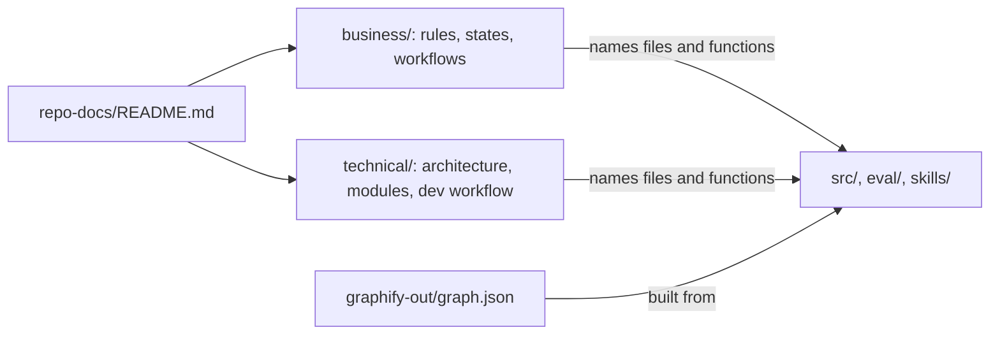

# gabriel repo docs

Developer docs for this repo, in the layout of [DOC-LAYOUT](../docs/DOC-LAYOUT.md). Docs are a lead: the code is the proof. User guides stay in [docs/](../docs/).

Checked against commit: 96ca7354

## Which doc?

| Question | Start here |
|---|---|
| What is gabriel for, and what are its parts? | [business/README.md](business/README.md), [01-domain-map](business/01-domain-map.md) |
| What must always hold (limits, gates, privacy)? | [02-business-rules](business/02-business-rules.md) |
| What happens on one prompt? | [W01-one-prompt](business/workflows/W01-one-prompt.md) |
| How do setup, add-docs and update work? | [W02](business/workflows/W02-first-setup-and-onboarding.md), [W03](business/workflows/W03-add-docs.md), [W04](business/workflows/W04-update-and-auto-add.md) |
| How does it learn and retrain? | [W05](business/workflows/W05-learning-from-use.md), [W06](business/workflows/W06-eval-and-retrain.md) |
| How do the modules fit? | [01-architecture](technical/01-architecture.md), [02-modules](technical/02-modules.md) |
| How do I build, test and release? | [03-dev-workflow](technical/03-dev-workflow.md) |
| What is known broken or out of date? | [findings](technical/findings.md) |
| What does a word mean? | [GLOSSARY](business/GLOSSARY.md) |

## How the docs connect

Caption: how the repo docs link to each other, and how they link to the code and the graph.

