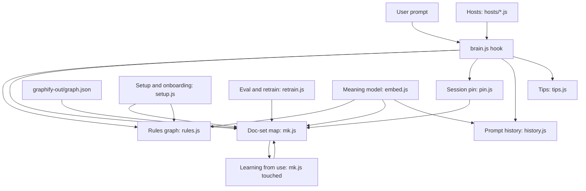

# 01 Domain map

gabriel's main parts are below. Each has one owner file in `src/`. Most feed the prompt hook; the rest set up, teach or score it.

Caption: the main parts of gabriel and the data each part passes to the next.

## The parts

| Part | Job | Owner files |
|---|---|---|
| Rules graph | Turns rule files and memory notes into nodes. Picks the few that match a prompt. | `src/rules.js` (`build`, `fresh`, `wordScores`, `rank`), `src/thesaurus.json` (synonyms) |
| Doc-set map | Turns each doc set into doc and code nodes (neurons) with links (synapses). Searches them from a prompt. | `src/mk.js` (`build`, `search`, `searchAll`, `format`), `src/extract.js` (`extractText`) |
| Session pin | Limits one session to one doc set (`gabriel use <set>`). | `src/pin.js` (`parsePin`, `getPin`, `setPin`), `src/brain.js` (`pinNote`) |
| Doc-set config | Lists the doc sets, their folders, aliases and options. | `src/projects.js` (`loadConfig`, `getProject`), `src/paths.js` |
| Code graph links | Reads `graphify-out/graph.json` made by `/graphify`. Links doc sections to code classes. Checks that the map matches the graph commit. | `src/mk.js` (`build`, `status`, `stale`, `sources`) |
| Learning from use | Links the prompt's top parts to a file the user opens or edits after a map. Links fade with time. | `src/mk.js` (`remember`, `touched`, `learnShow`, `learnReset`), `src/brain.js` (`touchedHook`) |
| Prompt history | Saves each prompt (redacted). Finds earlier prompts that look alike. Keeps a keyword graph of prompts. | `src/history.js` (`append`, `redact`, `searchHistory`, `formatHistory`, `forget`), `src/graphdb.js` |
| Hosts | Adapts input and output for each tool: Claude Code, Codex, Gemini CLI, Copilot, generic. | `src/hosts/index.js` (`get`), `src/hosts/claude.js`, `codex.js`, `gemini.js`, `copilot.js`, `generic.js` |
| Setup and onboarding | Installs packages, makes the data folder, fetches the meaning model, builds graphs and maps, adds doc sets, writes host hooks. | `src/setup.js` (`run`, `update`, `addDocs`, `hostSetup`), `src/migrate-data.js`, `skills/setup/SKILL.md` |
| Eval and retrain | Scores the map with test questions. Trains new ranking weights and keeps them only when they do not score lower (`--force` keeps them anyway). Optional model tune. | `eval/eval-map.js`, `eval/suggest-cases.js`, `src/retrain.js`, `src/train-rank.js`, `src/tune/tune.js` |
| Tips | One short tip per session, in the user's view only. | `src/tips.js` (`tipFor`) |
| Meaning model | A small local model that turns text into numbers, so similar text can match. Loaded without network at prompt time. | `src/embed.js` (`getEmbedder`, `embedNodes`, `readVectors`) |

## Data on disk

The data folder holds all of gabriel's state. It is `GABRIEL_DATA` when set, else the older `~/.claude/gabriel-data` when it exists, else `~/.gabriel` (`src/paths.js`, `dataDir`). Main files:

- `graph.json` (or `graph.<host>.json`): the rules graph.
- `mk.db`: the doc-set maps, learned links and each session's last map.
- `history/`: saved prompts, one file per month and machine.
- `seen/`: items already sent per session, the tip and setup-hint marks, and the session pin (`<session>.pin`).
- `projects.json`: the doc sets.
- `docs/<name>/`: doc sets kept in the data folder.
- `private/<name>/`: your eval cases and ranking weights.

Rule files live in each host's rules folder, for example `~/.claude` (`CLAUDE.md`, `preferences.md`, `projects/*/memory/`).

## Where the parts meet

- The prompt hook calls the rules graph, the doc-set map and the history. Limits: [02-business-rules.md](02-business-rules.md).
- The map and the rules graph share the meaning model. Without it, both fall back to words and synonyms.
- Learning only changes the map. It never changes the docs or the code graph.
- Retrain rebuilds one doc set's map. It may also replace that set's ranking weights (`rank.json`). Nothing else changes.
