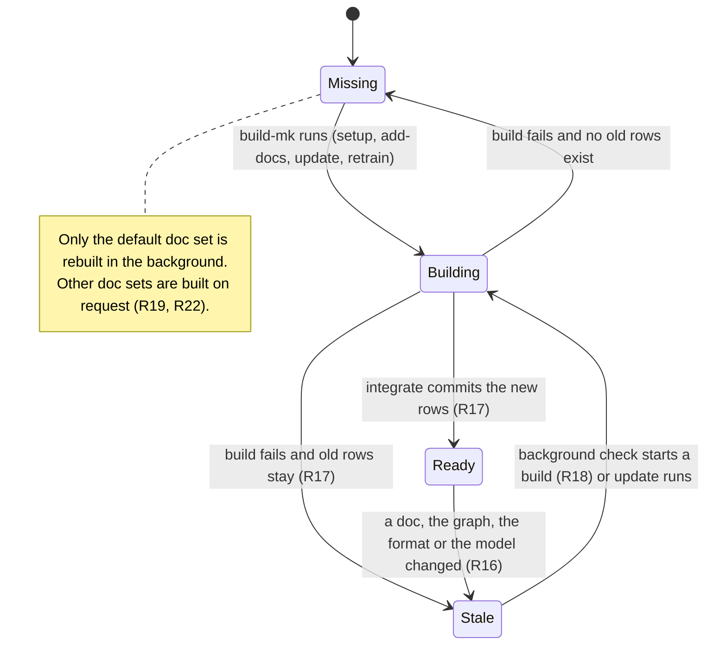
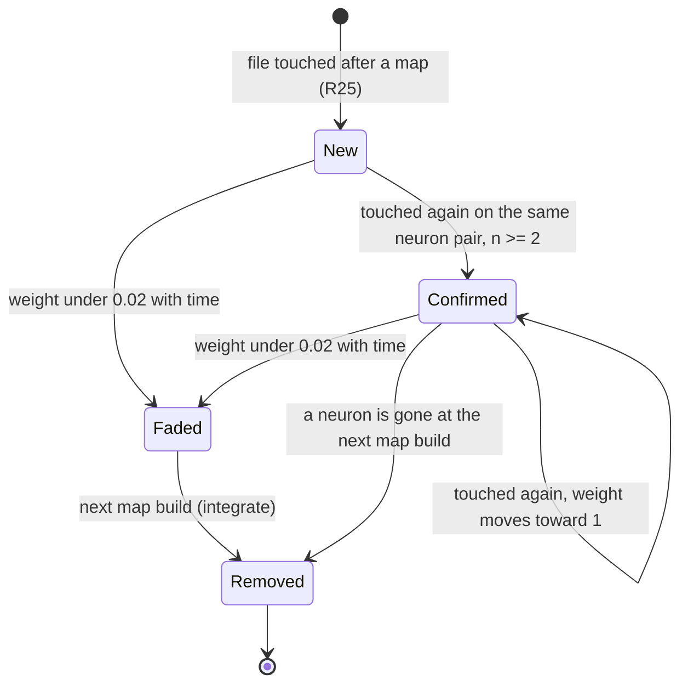

# 03 State machines

Two things have real states in the code: a doc set's map, and a learned link. Rules that move them are in [02-business-rules.md](02-business-rules.md).

## Doc-set map

A doc set is a project in `projects.json`. Its map lives in `mk.db`, one set of rows per doc set. The states are:

| State | Meaning | How to see it |
|---|---|---|
| Missing | No rows for this doc set yet. | `brain.js mk-status` says "no map". |
| Building | A build is running. The lock file `mk.lock` (for the default set) or the build is in progress. | Lock file younger than 10 minutes. |
| Ready | Rows match the current docs, graph, format and model. | `mk-status` says "ok". |
| Stale | Rows exist, but a source changed. The old rows still serve. | `mk-status` says "STALE". |

Notes:

- A lock file older than 10 minutes counts as no lock. A new build may then start (R18).
- The background check runs at most once a minute (R18). It is not a state. It only starts a build from Stale.

## Learned link

A learned link joins a doc or code neuron to a code neuron. It is made when a file is opened or edited after a map was shown (see [W05](workflows/W05-learning-from-use.md)). Its weight grows each time, fades with time, and is removed when it is too weak or a neuron is gone.

| State | Meaning | Used in search? |
|---|---|---|
| New | Confirmed once (`n` = 1). | No (needs 2, R23). |
| Confirmed | Confirmed at least twice. Its weight halves every 45 days (R23). | Yes, only to spread (R24). |
| Faded | Weight under 0.02. | No. Removed at the next map build (R23). |
| Removed | Gone from `learn`. | Not stored. |

Notes:

- A link that is New or Confirmed is kept only when its neurons still exist (`integrate()`).
- `brain.js learn-show` lists the strongest links with their faded weight. `brain.js learn-reset` removes all of them.
