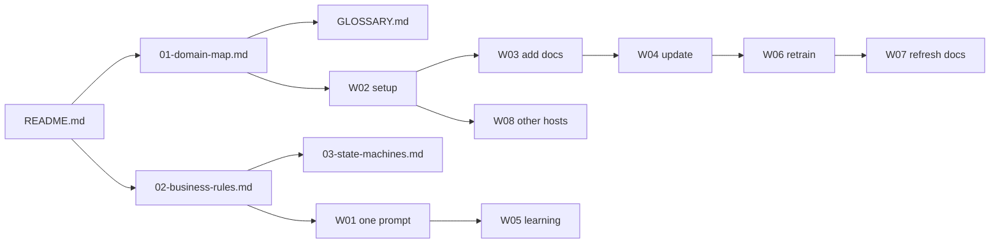

# gabriel: business docs

gabriel is a Claude Code plugin. On each prompt it adds the rules and doc sections that match the prompt. The model then sees the right rule, doc or code file before it answers.

It helps when a repo has many rule files, docs and a code graph. Without it, the model must find these by itself on every prompt.

Data stays on the user's PC. After setup, gabriel's own code makes no network call while a prompt is handled. See [02-business-rules.md](02-business-rules.md#r30-nothing-leaves-the-machine-after-setup).

## Who uses it

- **Developer** using Claude Code (or Codex, Gemini CLI, Copilot, or any tool that can run a command) on one or more repos.
- **Doc owner** who adds a folder of docs (a doc set) and keeps it current.
- **Tuner** who writes test questions and retrains the ranking.

## Which doc?

| Question | Open |
|---|---|
| What are the main parts and who owns them? | [01-domain-map.md](01-domain-map.md) |
| Which rule applies to this case? | [02-business-rules.md](02-business-rules.md) |
| What does a state mean (map ready, stale, learned link)? | [03-state-machines.md](03-state-machines.md) |
| What does a term mean? | [GLOSSARY.md](GLOSSARY.md) |
| What happens on one prompt? | [workflows/W01-one-prompt.md](workflows/W01-one-prompt.md) |

## Workflows

- [W01 one prompt](workflows/W01-one-prompt.md): what the hook adds to one prompt.
- [W02 first setup and onboarding](workflows/W02-first-setup-and-onboarding.md): install, data folder, first maps.
- [W03 add docs](workflows/W03-add-docs.md): add a doc set.
- [W04 update and auto-add](workflows/W04-update-and-auto-add.md): rebuild stale maps, pick up new folders.
- [W05 learning from use](workflows/W05-learning-from-use.md): opened files teach the map.
- [W06 eval and retrain](workflows/W06-eval-and-retrain.md): score and retrain the ranking.
- [W07 refresh docs](workflows/W07-refresh-docs.md): after code changes, update the docs.
- [W08 other hosts](workflows/W08-other-hosts.md): Codex, Gemini CLI, Copilot, generic tools.

Caption: how the business docs link to each other and to the workflows.

