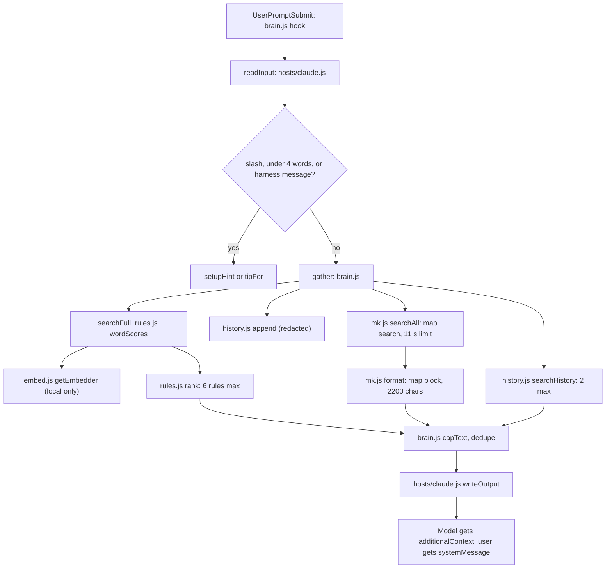

# W01 One prompt

## Trigger

The user sends a prompt in a host that has the gabriel hook. For Claude Code the hook is `UserPromptSubmit` in `hooks/hooks.json`, which runs `node src/brain.js hook`.

## Steps

1. The host sends the prompt as JSON on stdin. `src/hosts/claude.js` `readInput` (through `readCommon`) reads the prompt, session id, folder and transcript path.
2. `src/brain.js` `hook()` checks the prompt. A slash command, a prompt under 4 words or a harness message gets no context. It may get only the setup hint or a tip. See [R02](../02-business-rules.md#r02-short-and-slash-prompts-get-no-context).
3. `src/brain.js` `gather()` calls `searchFull()`. It scores the rules graph by words and synonyms (`src/rules.js` `wordScores`). If the meaning model is installed, it adds meaning scores (`src/embed.js` `getEmbedder`, with a 9 s limit).
4. `src/history.js` `append()` saves the prompt, redacted. See [R06](../02-business-rules.md#r06-prompt-history-hides-secrets-and-has-a-size-cap).
5. `gather()` starts two background checks: `refreshInBackground()` (embed new rules) and `refreshMapInBackground()` (rebuild a stale map). See [W04](W04-update-and-auto-add.md).
6. Rules block: `src/rules.js` `rank()` keeps at most 6 rules. `src/brain.js` `format()` cuts the block at 2400 characters. See [R03](../02-business-rules.md#r03-rules-block-at-most-6-rules-and-2400-characters).
7. Map block: `src/brain.js` `mapFor()` calls `src/mk.js` `searchAll()`, then `format()`. It skips the search after 11 s. See [R08](../02-business-rules.md#r08-map-block-at-most-6-doc-hits-and-6-code-hits-2200-characters) and [R09](../02-business-rules.md#r09-one-doc-set-leads-a-close-second-gets-a-short-block).
8. Similar earlier prompts: `src/history.js` `searchHistory()` (at most 2, score 0.60 or more), then `formatHistory()`.
9. `capText()` cuts the text to the host limit (none for Claude, 9000 for Codex).
10. `dedupe()` drops items already sent in this session. See [R07](../02-business-rules.md#r07-an-item-is-not-sent-twice-in-one-session).
11. A tip or the setup hint is added once per session: `src/tips.js` `tipFor()`, `src/brain.js` `setupHint()`. See [R28](../02-business-rules.md#r28-one-tip-per-session) and [R29](../02-business-rules.md#r29-setup-hint-until-setup-is-done).
12. `src/hosts/claude.js` `writeOutput()` sends the text to the model (`additionalContext`) and a short view to the user (`systemMessage`, from `humanize()`). Then `dedupe()`'s `save()` runs.

## Rules and states

- Limits and gates: [02-business-rules.md](../02-business-rules.md) R01, R02, R03, R07, R08, R09, R10, R11, R12, R13.
- Map states the search depends on: [03-state-machines.md](../03-state-machines.md#doc-set-map).
- Learned links used in the map search: [R23](../02-business-rules.md#r23-a-learned-link-needs-two-confirmations-and-fades) and [R24](../02-business-rules.md#r24-learned-links-never-start-a-search).

## Result

- The model gets the rules, the map block and the earlier prompts as extra context for this turn.
- The user sees a short list in `systemMessage`.
- The prompt is saved in `<data>/history/` (one file per month and machine).
- The items sent are saved in `<data>/seen/<session>.json`.
- Nothing is written to the rules folder or to the docs.
- Check: `node src/brain.js context "<prompt>"` prints the same text as plain text.
