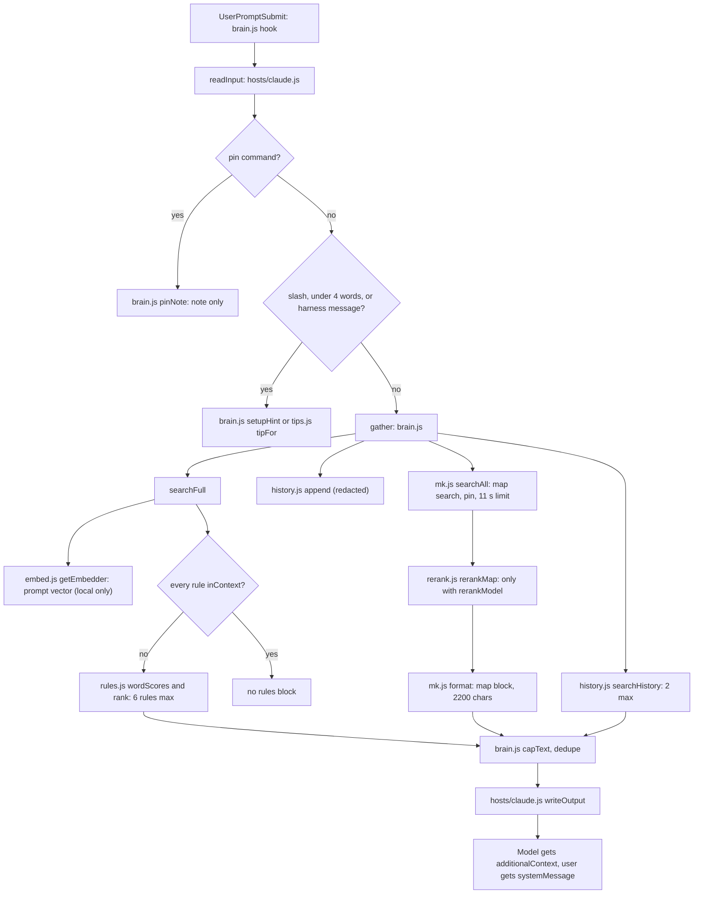

# W01 One prompt

## Trigger

The user sends a prompt in a host with the gabriel hook. In Claude Code: `UserPromptSubmit` in `hooks/hooks.json` runs `node src/brain.js hook`.

## Steps

1. The host sends the prompt JSON on stdin. `src/hosts/claude.js` `readInput` (via `readCommon`) reads the prompt, session id, folder and transcript path.
2. `src/brain.js` `hook()` first checks for a pin command (`gabriel use ...`). It answers with a note and stops ([R35](../02-business-rules.md#r35-session-pin)). Then a slash command, a prompt under 4 words or a harness message gets no context, only the setup hint or a tip ([R02](../02-business-rules.md#r02-short-and-slash-prompts-get-no-context)).
3. `gather()` calls `searchFull()`. When the model loads, it embeds the prompt (`src/embed.js` `getEmbedder`, 9 s limit), also when the rule vectors are missing (just after a model change). The map and the history search use this vector. It scores the rules graph by words and synonyms (`src/rules.js` `wordScores`) and, when the rule vectors match the model, by meaning. When every rule node is `inContext`, it skips the scoring, because `rank()` drops those nodes. `src/graphdb.js` `lexical()` fills free history slots with exact rare words.
4. `src/history.js` `append()` saves the prompt, redacted. See [R06](../02-business-rules.md#r06-prompt-history-hides-secrets-and-has-a-size-cap).
5. `gather()` starts two background checks: `refreshInBackground()` (embed new rules) and `refreshMapInBackground()` (rebuild a stale map). See [W04](W04-update-and-auto-add.md).
6. Rules block: `src/rules.js` `rank()` keeps at most 6 rules. `src/brain.js` `format()` cuts the block at 2400 characters. See [R03](../02-business-rules.md#r03-rules-block-at-most-6-rules-and-2400-characters).
7. Map block: `src/brain.js` `mapFor()` calls `src/mk.js` `searchAll()` (with the session pin, if any). `search()` then sets each code line's line from the set's repo folder (`src/repo.js` `exactLines()`, [R36](../02-business-rules.md#r36-exact-code-lines)). When `rerankModel` is set, `src/rerank.js` `rerankMap()` rescores the code pool in the time left; on any problem it keeps the list. `mk.remember()` stores the search seeds for learning. Then `format()`. It skips the search after 11 s. See [R08](../02-business-rules.md#r08-map-block-at-most-6-doc-hits-and-6-code-hits-2200-characters), [R09](../02-business-rules.md#r09-one-doc-set-leads-a-close-second-gets-a-short-block) and [R34](../02-business-rules.md#r34-two-links-away-code-names).
8. Similar earlier prompts: `src/history.js` `searchHistory()` (at most 2, score 0.60 or more), then `formatHistory()`.
9. `capText()` cuts the text to the host limit (none for Claude, 9000 for Codex).
10. `dedupe()` drops items already sent in this session. See [R07](../02-business-rules.md#r07-an-item-is-not-sent-twice-in-one-session).
11. One hint line may be added, in this order (the drift warning on every 2nd prompt, the others once per session): the setup hint (`src/brain.js` `setupHint()`), the warnings (`driftNote()`, `missNote()`; they ignore `tips: false`), then a tip (`src/tips.js` `tipFor()`). See [R28](../02-business-rules.md#r28-one-tip-per-session) and [R29](../02-business-rules.md#r29-setup-hint-until-setup-is-done).
12. `writeOutput()` sends the text to the model (`additionalContext`) and a short view to the user (`systemMessage`, from `humanize()`). The pin line, when set, starts every user note ([R35](../02-business-rules.md#r35-session-pin)). Then `dedupe()`'s `save()` runs.

## Diagram

Caption: the steps one prompt takes, from the hook to the text the model and the user get.

## Rules and states

- Limits and gates: [02-business-rules.md](../02-business-rules.md) R01, R02, R03, R07 to R13, R34, R35.
- Map states and learned links: [03-state-machines.md](../03-state-machines.md#doc-set-map), [R23](../02-business-rules.md#r23-a-learned-link-needs-two-confirmations-and-fades), [R24](../02-business-rules.md#r24-learned-links-never-start-a-search).

## Result

- The model gets the rules, map block and earlier prompts for this turn. The user sees a short list in `systemMessage`.
- The prompt is saved in `<data>/history/`. Sent items go to `<data>/seen/<session>.json`; a pin command writes `<data>/seen/<session>.pin` instead.
- Nothing is written to the rules folder or the docs.
- Check: `node src/brain.js context "<prompt>"` prints the same text as plain text.
