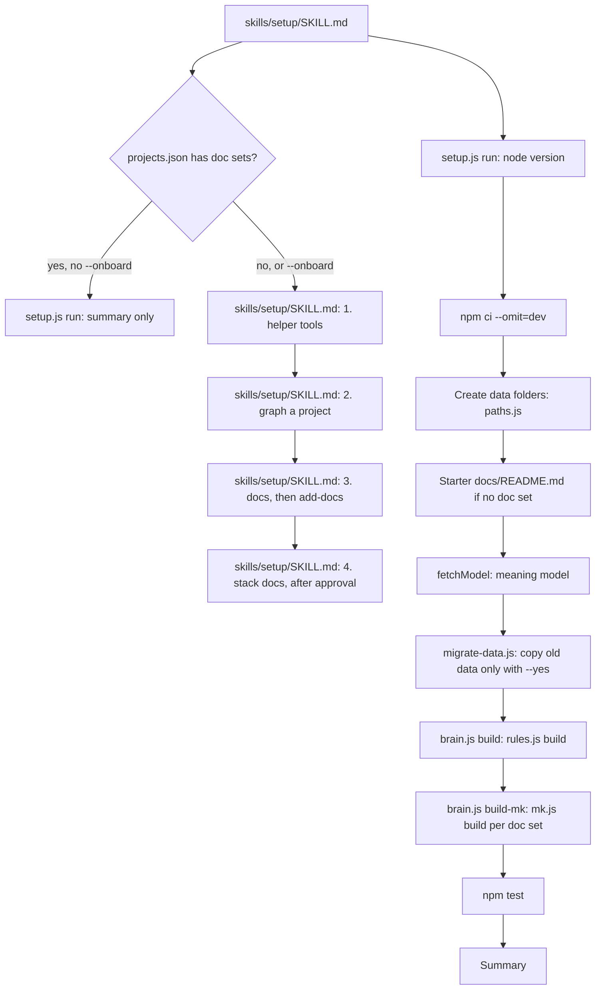

# W02 First setup and onboarding

## Trigger

The user runs `/gabriel:setup` after installing the plugin. The skill `skills/setup/SKILL.md` runs `node src/setup.js`. It also runs the optional onboarding when no doc set exists yet (or when the user passes `--onboard`).

## Steps

Setup, in `src/setup.js` `run()`:

1. **Node version.** Node 22.5 or newer is needed. Otherwise setup stops.
2. **Packages.** `npm ci --omit=dev` in the plugin folder. Skipped when the pinned `@huggingface/transformers` is already installed.
3. **Data folder.** Creates `docs/`, `docs/stack/`, `private/` and `models/` under the data folder (`src/paths.js` `dataDir`).
4. **Starter file.** When there is no doc set, writes `docs/README.md` with the next steps. It is a file, so it does not become a doc set.
5. **Meaning model.** `fetchModel()` downloads `Xenova/all-MiniLM-L6-v2` (about 23 MB) into `models/`. Skipped with `--skip-model`. See [R30](../02-business-rules.md#r30-nothing-leaves-the-machine-after-setup).
6. **Old data.** If `~/.claude/brain` holds a `mk.db`, `src/migrate-data.js` `migrate()` plans the copy. It copies only with `--yes`. See [R32](../02-business-rules.md#r32-old-data-is-copied-never-deleted).
7. **Rules graph.** `src/brain.js build` writes the rules graph (`src/rules.js` `build()`).
8. **Doc maps.** `src/brain.js build-mk <name>` for each doc set (`src/mk.js` `build()`).
9. **Tests.** `npm test`. A failure is printed and setup goes on.
10. **Summary.** Data folder, doc sets and doc counts, and a note about the graphify skill.

Onboarding, in `skills/setup/SKILL.md` (Claude asks each question with AskUserQuestion, and does nothing the user did not pick):

1. **Helper tools.** Optional installs: graphify, superpowers, ponytail.
2. **Graph a project.** Optional. Asks for the code folder and a name. Makes `<name>-code-docs/` next to the code, runs `/graphify <code folder>`, moves `graphify-out/` into that folder and checks its commit against the code's `HEAD`.
3. **Docs from the graph.** Optional technical, business, architecture and workflow docs in `<name>-code-docs/docs/`, in the layout of `docs/DOC-LAYOUT.md`. Then `/gabriel:add-docs` with `--code` and `--repo` (see [W03](W03-add-docs.md)), then `docs-checked <name>` so the drift warning starts from here ([R37](../02-business-rules.md#r37-drift-warning)).
4. **Stack docs.** Optional public docs for the user's languages and frameworks, fetched after the user approves the list. Saved under `docs/stack/`.

## Diagram

Caption: the setup script steps, then the onboarding steps that wait for the user to pick each one.

## Rules and states

- Model download and network: [R30](../02-business-rules.md#r30-nothing-leaves-the-machine-after-setup).
- Copy of old data: [R32](../02-business-rules.md#r32-old-data-is-copied-never-deleted).
- Map states after build: [03-state-machines.md](../03-state-machines.md#doc-set-map).
- Setup hint until setup is done: [R29](../02-business-rules.md#r29-setup-hint-until-setup-is-done).

## Result

- Packages in the plugin folder, and the data folder with `docs/`, `private/`, `models/`, `graph.json` and `mk.db` (once a doc set exists).
- The model in `<data>/models/`, unless skipped.
- Setup prints each step. A failed step stops setup (steps 1, 2 and 7) or is printed (step 8 and 9).
- Check: `node src/brain.js mk-status all` shows one block per doc set.
- Onboarding writes only what the user picked. Each step has its own result.
