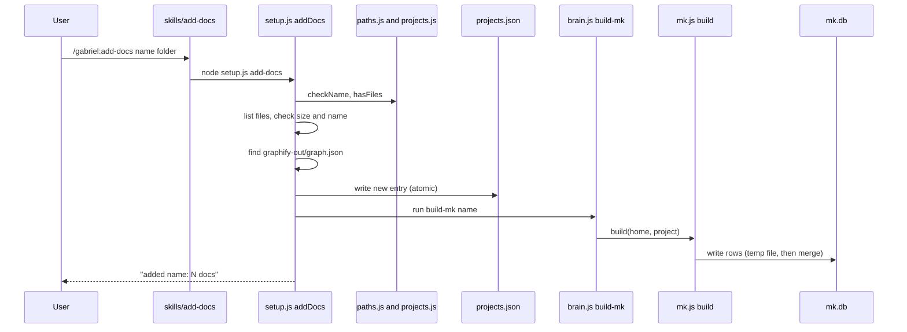

# W03 Add docs

## Trigger

The user runs `/gabriel:add-docs <name> <folder> [--copy] [--code <repo>] [--yes]`, or `/gabriel:add-docs <name> --code <repo> --relink` to change only the code repo of a set that exists. The skill `skills/add-docs/SKILL.md` runs `node src/setup.js add-docs`. The skill is for the user only: the model does not start it. The skill asks for the code repo when `--code` is missing.

## Steps

In `src/setup.js` `addDocs()`:

1. **Read the options.** `--copy` copies the files into the data folder. `--code <repo>` names the repo whose `graphify-out/graph.json` is used. `--yes` lifts the size limit. Two positional values are needed: the name and the folder.
2. **Check the name.** `src/paths.js` `checkName()`. See [R21](../02-business-rules.md#r21-folder-names-are-short-and-plain).
3. **Check the folder.** It must exist and hold at least one doc file. `listDocFiles()` counts the files and the bytes. Files with an extension that is not read by default are counted and named.
4. **Check the name is free.** A name already in `projects.json` is refused. See [R22](../02-business-rules.md#r22-add-docs-refuses-a-used-name-or-a-huge-folder).
5. **Check the size.** Over 20000 files or 500 MB needs `--yes`.
6. **Find the code graph.** With `--code`, only `<repo>/graphify-out/graph.json` counts. If it is missing, the command stops before any write (no fallback). Without `--code`, it looks in the docs folder. `graphRel()` must reach the file on the same drive. With no graph but code files in the folder, it suggests `/graphify`. See [R33](../02-business-rules.md#r33-a-code-graph-must-exist-and-match-the-docs).
7. **Copy (with `--copy` only).** Copies the files to `<data>/docs/<name>/`. A failed copy removes the new folder.
8. **Write `projects.json`.** If the file does not exist yet, it starts from the folders under `docs/` that hold files (`src/projects.js` `hasFiles()`). Then it adds the new entry with its folder, its graph and its alias.
9. **Build the map.** `src/brain.js build-mk <name>` runs `src/mk.js` `build()` in a child process. It runs after the write, so the child reads the new entry. The build prints a `warning:` line when almost no doc section links to the code.

## Relink (`--relink`)

1. Check the set exists in `projects.json` (`unknown doc set` if not), and that `--code` is given.
2. Check `<repo>/graphify-out/graph.json` (same rule as step 6).
3. Write only that set's `graph` entry, then rebuild its map. Nothing else in the entry changes.

## Rules and states

- Name, size, duplicate and copy rules: [R21](../02-business-rules.md#r21-folder-names-are-short-and-plain) and [R22](../02-business-rules.md#r22-add-docs-refuses-a-used-name-or-a-huge-folder).
- A new doc set starts as Missing, then Ready: [03-state-machines.md](../03-state-machines.md#doc-set-map).
- Doc sets with no `projects.json`: [R20](../02-business-rules.md#r20-without-projectsjson-every-folder-with-files-is-a-doc-set).

## Result

- `<data>/projects.json` has one new entry: name, root (the folder, or `docs/<name>` with `--copy`), graph path if found, layout `auto`, an alias with the name, and with `--code` a `cwdHints` list. The hint is the lower-case repo name. If the repo sits inside a git repo, it is the git repo's name instead. `--relink` does not change `cwdHints`.
- `<data>/mk.db` has the new doc set's rows, or a message that the map was not built. A failed build still leaves the entry in `projects.json`. The message gives the retry command.
- From then on, a prompt that uses the name routes to this doc set (see [R12](../02-business-rules.md#r12-a-named-doc-set-gets-the-prompt-first)).
- With `--copy`, the files are also in `<data>/docs/<name>/`.
- With `--relink`, only the `graph` entry of that set changes, and its map is rebuilt.
- Check: `node src/brain.js mk-status all`.
