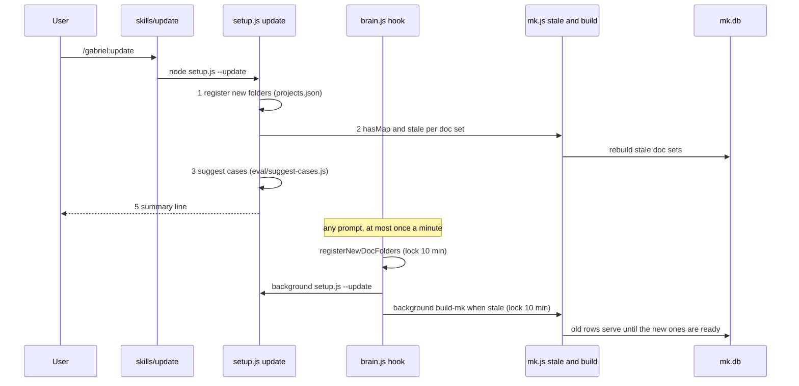

# W04 Update and auto-add

## Trigger

Two triggers:

- **The user** runs `/gabriel:update [--dry-run] [--stack]`. The skill `skills/update/SKILL.md` runs `node src/setup.js --update`.
- **A prompt** (background). The prompt hook sees a new doc folder, or a map that is stale. It starts the same work by itself, at most once a minute.

## Steps

### User run: `setup.js` `update()`

Before step 1, a set with no aliases gets its name as its alias. The run prints `set alias for <name>` for each one, and writes `projects.json` unless it is a dry run. Fallback sets are skipped.

1. **Register new folders.** With a `projects.json`, a folder under `docs/` that holds files and is not yet a doc set is added. Without one, auto mode already reads every folder, so nothing is added. See [R19](../02-business-rules.md#r19-new-doc-folders-join-only-when-they-hold-files).
2. **Rebuild stale maps.** For each doc set: if it has no map or `mk.stale()` is true, `src/brain.js build-mk <name>` runs. Others are printed as up to date. A folder that is gone is skipped with a warning.
3. **Suggest cases.** For doc sets with a reviewed `eval-cases.json`, `eval/suggest-cases.js` `newSuggestions()` adds cases for new sections to `eval-cases.suggested.json`. It never writes `eval-cases.json`.
4. **Next steps.** Prints "run /gabriel:retrain <name>" for each doc set with cases.
5. **Summary.** Counts: added, rebuilt, up to date, new suggested cases, failed.

With `--dry-run`, every step prints what it would do and changes nothing.

With `--stack`, the skill first fetches the stack docs again. It lists the sources, the user picks which, and a low-cost subagent downloads them. Then it runs the update without `--stack`.

### Background run: `brain.js` (prompt hook)

1. `refreshMapInBackground()` checks at most once a minute (a stamp file). It does nothing when a build lock is younger than 10 minutes.
2. `registerNewDocFolders()` looks for a new doc folder. If it finds one, it starts `setup.js --update` in the background and stops here (the update builds the new map).
3. Otherwise, `src/mk.js` `stale()` checks each doc set in turn and picks the first stale one. A set whose graph file is missing is skipped. When one is stale, `brain.js build-mk` starts in the background, with a lock file `mk.lock`. The lock file holds the set name. A build removes the lock when it is the default set or the named set.
4. The old map keeps serving until the new one is ready (see [R17](../02-business-rules.md#r17-the-old-map-serves-until-the-new-one-is-ready)).

## Rules and states

- New folders join only when they hold files: [R19](../02-business-rules.md#r19-new-doc-folders-join-only-when-they-hold-files).
- Rebuild when a source changed: [R16](../02-business-rules.md#r16-a-doc-set-map-is-rebuilt-when-its-sources-change).
- One background build at a time, checked each minute: [R18](../02-business-rules.md#r18-background-builds-one-at-a-time-checked-each-minute).
- Old map serves during a build: [R17](../02-business-rules.md#r17-the-old-map-serves-until-the-new-one-is-ready).
- Map states: [03-state-machines.md](../03-state-machines.md#doc-set-map).

## Result

- `projects.json` has the new doc sets (step 1).
- `mk.db` has fresh rows for each rebuilt doc set.
- `eval-cases.suggested.json` may get new cases. The user reviews them. `eval-cases.json` is not changed.
- The summary line shows the counts. Any failed doc set has a retry command.
- Check: `node src/brain.js mk-status all` prints one block per doc set (`ok` or `STALE`).
