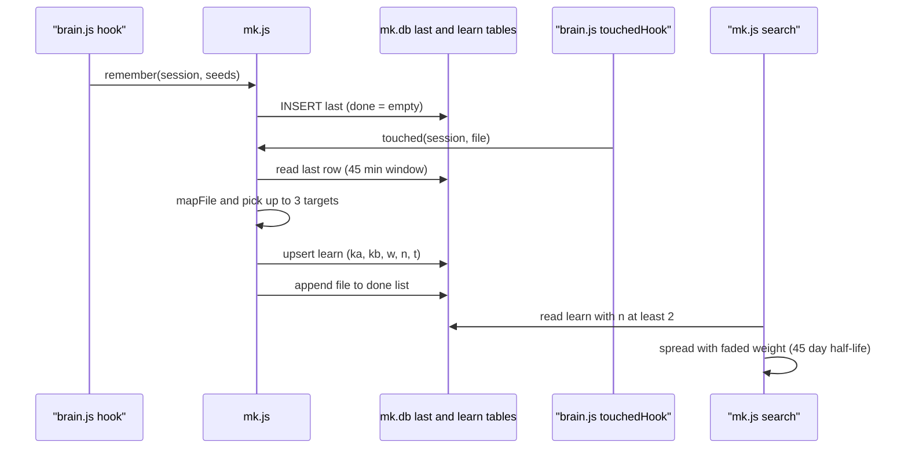

# W05 Learning from use

## Trigger

Two events in order:

1. A prompt gets a map block (see [W01](W01-one-prompt.md), step 7).
2. The user, or the model, opens or edits a file after that, with `Read`, `Edit`, `Write`, `MultiEdit` or `NotebookEdit`. The `PostToolUse` hook runs `node src/brain.js touched`.

## Steps

1. **Remember the seeds.** When a map block is made, `src/mk.js` `remember()` saves the prompt's top 10 seeds for this session in the `last` table. Learning later uses the first 8. The fallback doc set saves nothing.
2. **Read the file.** `src/brain.js` `touchedHook()` reads the file path from the tool input (`src/hosts/claude.js` `readTouched`). It stops when there is no session id or no path.
3. **Check the window.** `mk.js` `touched()` needs a `last` row for this session, made no more than 45 minutes ago (`LEARN_WINDOW_MS`). Otherwise it does nothing.
4. **Check the file.** The file must be a file in that doc set's map (`mapFile()`). A file already counted for this map is skipped. A code file inside the set's repo that the map does not know is added to the session's miss list (`isRepoCodeFile()`, `noteMiss()`, see [R38](../02-business-rules.md#r38-miss-warning)).
5. **Pick the targets.** Up to 3 main code classes of that file, not generic names, with degree of 600 or less (`LEARN_TARGETS`, `HUB`).
6. **Learn.** For each seed and each target, the link weight grows: `w + 0.2 × activation × (1 − w)`, capped at 1. The confirmation count goes up by one. See [R23](../02-business-rules.md#r23-a-learned-link-needs-two-confirmations-and-fades).
7. **Use the link next time.** `mk.js` `search()` reads the links with at least 2 confirmations. It spreads from them, never starts from them (see [R24](../02-business-rules.md#r24-learned-links-never-start-a-search)).
8. **Clean up at rebuild.** `integrate()` removes links whose neurons are gone and links that have faded under 0.02.

Other commands: `brain.js learn-show` lists the strongest links. `brain.js learn-reset [name]` forgets all of them, or one doc set's with a name. `brain.js touched-files <file>` learns from files a Codex step changed. It uses the newest map of any session in the last 45 minutes.

## Diagram

Caption: how a map block and a later file touch teach the learned links that the next prompt uses.

## Rules and states

- Window, once per file, and up to 3 targets: [R25](../02-business-rules.md#r25-a-file-counts-once-per-map-within-45-minutes).
- Confirmation count, fade and pruning: [R23](../02-business-rules.md#r23-a-learned-link-needs-two-confirmations-and-fades).
- Learned links never start a search: [R24](../02-business-rules.md#r24-learned-links-never-start-a-search).
- Link states: [03-state-machines.md](../03-state-machines.md#learned-link).

## Result

- New or stronger rows in the `learn` table of `mk.db`, tagged with the doc set.
- The `last` row for the session gets the file added to its done list.
- The next prompt on the same topic may rank the opened file's main classes higher. Nothing in the docs or the code graph changes.
- Check: `node src/brain.js learn-show 15` lists the strongest links with their current weight.
- Undo: `node src/brain.js learn-reset [name]` deletes all learned links and the `last` rows (with a name: that doc set's only).
