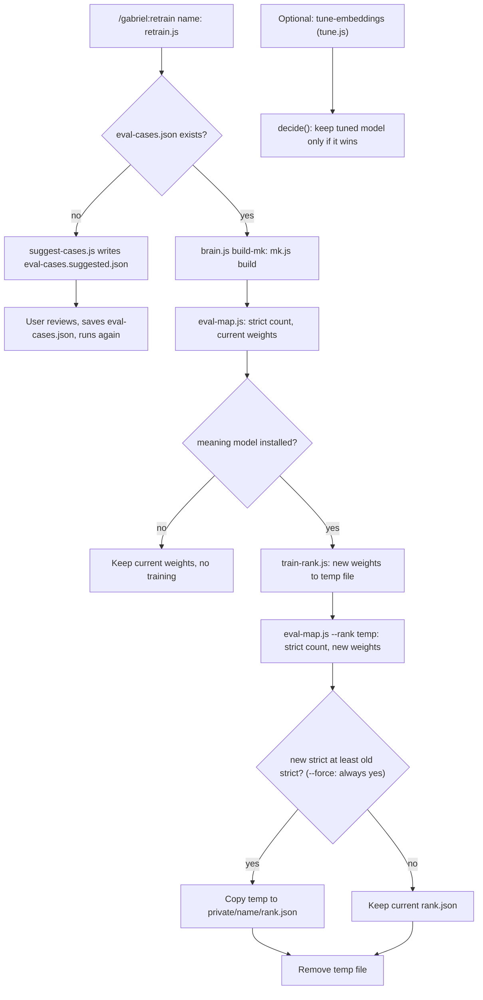

# W06 Eval and retrain

## Trigger

- **The user** runs `/gabriel:retrain [name]`. With no name, the default doc set is used. The skill `skills/retrain/SKILL.md` runs `node src/retrain.js`.
- **The end of** [W07](W07-refresh-docs.md), which asks whether to retrain after the docs change.
- **Optional, slow:** `/gabriel:tune-embeddings` tunes the meaning model (covered at the end).

## Steps

In `src/retrain.js`:

1. **Check for eval cases.** The file is `<data>/private/<name>/eval-cases.json`. If it is missing, `eval/suggest-cases.js` writes `eval-cases.suggested.json` from the doc sections, and retrain stops. The user reviews the file, saves it as `eval-cases.json`, and runs retrain again.
2. **Rebuild the map.** `src/brain.js build-mk <name>`. If the build fails, retrain stops. See [W04](W04-update-and-auto-add.md).
3. **Score the current weights.** `eval/eval-map.js --project <name>` prints the strict count, for example `strict 12/15`. A strict pass means the expected doc section and code class are found. The quiet count means unrelated questions show no map block.
4. **Train.** `src/train-rank.js --project <name> --out <temp file>` writes new weights to a temp file. If the meaning model is not installed, training is skipped and the current weights stay.
5. **Score the new weights.** `eval/eval-map.js --project <name> --rank <temp file>`.
6. **Keep new or current weights.** No name means the default doc set. The new file is copied to the doc set's `rank.json` only when its strict count is not lower. `--force` copies it anyway, and the old file is saved as `rank.prev.json`. The temp file is removed in every case. See [R26](../02-business-rules.md#r26-retrain-keeps-new-weights-only-when-the-strict-score-does-not-fall).

Optional tune, in `src/tune/tune.js`: it scores the current and the tuned meaning model on a copy of the data folder, and keeps the tuned model only when `decide()` passes ([R27](../02-business-rules.md#r27-model-tune-keeps-the-tuned-model-only-when-it-wins)). `--rollback` removes the tuned model setting from `projects.json`.

## Diagram

Caption: the retrain steps: check the cases, rebuild the map, score, train, and keep new weights only if the score holds.

## Rules and states

- Keep rule for the ranking weights: [R26](../02-business-rules.md#r26-retrain-keeps-new-weights-only-when-the-strict-score-does-not-fall).
- Keep rule for the tuned model: [R27](../02-business-rules.md#r27-model-tune-keeps-the-tuned-model-only-when-it-wins).
- The map is rebuilt before scoring, so the scores match the current docs: [R16](../02-business-rules.md#r16-a-doc-set-map-is-rebuilt-when-its-sources-change).
- Term definitions (strict, quiet, held-out): [GLOSSARY.md](../GLOSSARY.md).

## Result

- `rank.json` for the doc set is replaced, or left as it was. The console says which, with both scores.
- The map is rebuilt in any case, so `mk.db` is current.
- No eval case is changed by retrain. Only the user edits `eval-cases.json`.
- If the tune ran: a before and after table. The tuned model is kept or rolled back. The real data folder is not changed until the scores say keep.
- Check: `node eval/eval-map.js --project <name>` prints the current strict and quiet counts.
