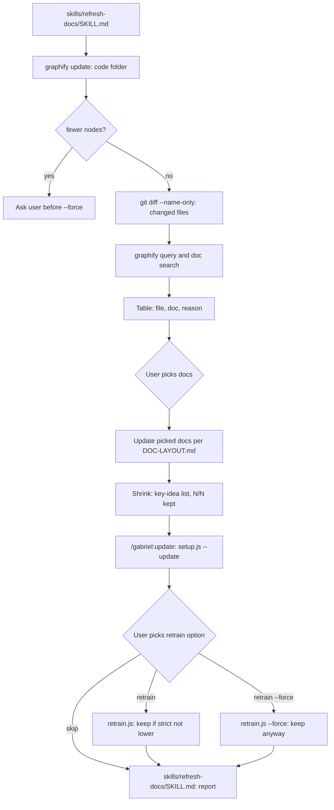

# W07 Refresh docs

## Trigger

The user runs `/gabriel:refresh-docs <doc set name>` after code changes. The other form is `/gabriel:refresh-docs <code folder> [docs folder]`. The skill `skills/refresh-docs/SKILL.md` drives the work. Claude does most steps. The skill never commits or pushes.

The skill finds the folders from `projects.json`: the set's `repo` is the code folder, its `root` is the docs folder, and the graph folder is the folder above its `graphify-out`. If a folder is missing, the skill falls back to the `.graphify_root` file or the git root, then asks the user.

## Steps

1. **Refresh the graph.** Check that `graphify --help` works. Run `graphify update <code folder>` in the background. When the graph folder is not the code folder, it adds `--graph` so the graph is written to the graph folder and the code repo stays clean. It re-reads code only and needs no model. Compare node counts. If graphify refuses because the new graph has fewer nodes, the skill shows the counts and asks before it adds `--force`. The skill never reads `graph.json` whole.
2. **Find the docs the change touches.** List changed files with `git diff --name-only <old commit>..HEAD` in the code folder. For each, run `graphify query` and search the docs folder for its names. Show a table of changed file, doc, and reason. The user picks the docs.
3. **Update the picked docs.** Read `docs/DOC-LAYOUT.md` first. Confirm each claim in the code. Fix names, paths, steps, rules and diagrams. Add what is new, remove what is gone. Keep the doc's structure.
4. **Shrink the updated docs.** Write a key-idea list before the edit. Shorten the text. List each cut with its rule. Check the key-idea list after the edit: every idea must still be there, or moved and linked. Report "key ideas kept: N/N".
5. **Run the update.** `/gabriel:update` rebuilds the changed maps. See [W04](W04-update-and-auto-add.md).
6. **Ask about retrain.** The user picks one of three: skip; `/gabriel:retrain <name>` (keep the new weights only if the strict score does not fall); or retrain and replace anyway (`node src/retrain.js <name> --force`). Do what the user picks. If the update made new suggested cases, the user must save them first. Skip the optional model tune. See [W06](W06-eval-and-retrain.md).
7. **Record the check.** Last, after the docs are updated, run `node src/brain.js docs-checked <name>`. It writes the repo HEAD to `docs-checked.json`, so the drift warning (see [R37](../02-business-rules.md#r37-drift-warning)) knows the docs are current.

## Diagram

Caption: the refresh-docs steps, from the graph update to the docs the user picks, the map update and the retrain choice.

## Rules and states

- Map rebuild after a doc change: [R16](../02-business-rules.md#r16-a-doc-set-map-is-rebuilt-when-its-sources-change).
- Retrain keep rule, and the `--force` exception: [R26](../02-business-rules.md#r26-retrain-keeps-new-weights-only-when-the-strict-score-does-not-fall).
- The doc layout and lean rules that every edit follows: `docs/DOC-LAYOUT.md`.
- No state of its own. The map states it moves are in [03-state-machines.md](../03-state-machines.md#doc-set-map).

## Result

- The code graph (`graphify-out/graph.json`) is updated in the graph folder.
- The picked docs are changed. Each has a before and after line count, a cut list and "key ideas kept: N/N".
- The doc set's map is rebuilt. Its ranking is retrained only if the user picks a retrain option.
- Nothing is committed. The user commits.
- The skill asks for valid Mermaid (double-quoted labels). It does not render the diagrams, so a render check is still needed.
