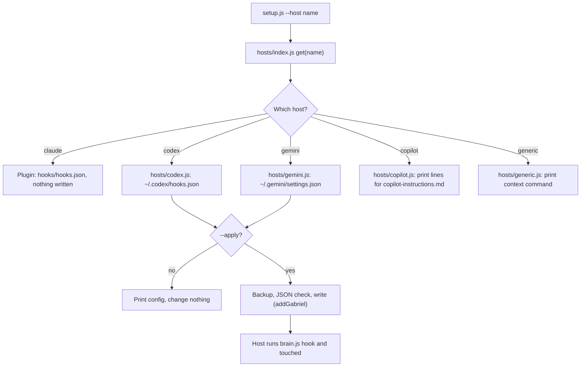

# W08 Other hosts

## Trigger

The user runs `node src/setup.js --host <name>` to see what gabriel adds for a tool, and adds `--apply` to write it. `--remove-host <name> --apply` takes gabriel back out. The names are `claude`, `codex`, `gemini`, `copilot` and `generic`.

## Steps

1. **Pick the adapter.** `src/setup.js` `hostSetup()` calls `src/hosts/index.js` `get()`. An unknown name is an error.
2. **Claude Code.** The adapter has no setup. Gabriel is a Claude Code plugin, so `hooks/hooks.json` does the work. Setup writes nothing.
3. **Codex.** The hook file is `~/.codex/hooks.json` (`src/hosts/codex.js`). It adds `UserPromptSubmit` (a `hook` call) and `PostToolUse` for `apply_patch`, `Read`, `Edit` and `Write`. Codex reads the file paths from the patch text. Output is cut at 9000 characters. Timeouts are in seconds.
4. **Gemini CLI.** The hook file is `~/.gemini/settings.json` (`src/hosts/gemini.js`). It adds `BeforeAgent` (a `hook` call) and `AfterTool` for `write_file`, `replace` and `read_file`. Output is only the model text, with no user line. Timeouts are in milliseconds.
5. **Copilot.** No hook file. Setup prints two lines to add to `~/.copilot/copilot-instructions.md`. They tell Copilot to run `brain.js context "<question>" --host copilot` before it answers about a project (`src/hosts/copilot.js`).
6. **Generic.** No hook file. Any tool can call `node src/brain.js context "<prompt>" --host generic` (`src/hosts/generic.js`). The rules folder is `GABRIEL_RULES_HOME`, then `BRAIN_HOME`, then `~/.claude`.
7. **Without `--apply`.** The config is printed and nothing is written. See [R31](../02-business-rules.md#r31-host-hook-files-change-only-with---apply-after-a-backup).
8. **With `--apply`.** The file is read and checked as JSON (a broken file stops the run). A backup is copied next to it. Then gabriel's entries are added or updated. Other hooks stay. `--remove-host` removes only the entries with the gabriel command.

For Codex and Gemini the data folder is passed on the command line (`--data`), because those tools do not see Claude Code's settings.

## Diagram

Caption: how `setup.js --host` picks an adapter, and writes a host's hook file only with `--apply`.

## Rules and states

- Only `--apply` writes, with a backup first: [R31](../02-business-rules.md#r31-host-hook-files-change-only-with---apply-after-a-backup).
- Each host has its own rules folder and context file: Claude `CLAUDE.md`, Codex `AGENTS.md`, Gemini `GEMINI.md`, Copilot `copilot-instructions.md`, generic none. Context files are never repeated (see [R04](../02-business-rules.md#r04-rules-already-in-context-are-not-repeated)).
- Output size: Codex has the 9000 character cap (see [R03](../02-business-rules.md#r03-rules-block-at-most-6-rules-and-2400-characters)).
- Each host has its own rules graph file (`graph.<host>.json`). Two hosts never overwrite each other (`src/rules.js` `graphName()`).

## Result

- For Codex and Gemini: the hook file has gabriel's entries, and a backup file exists when the file was there before.
- For Copilot and generic: the printed lines are the only output. The user adds them by hand.
- For Claude Code: no change from setup.
- Check: `node src/setup.js --host <name>` (no `--apply`) prints "already set up: nothing to change" when the file is correct.
