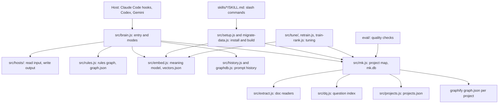
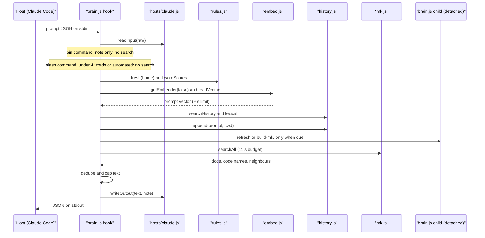

# Architecture

gabriel is a Node.js plugin (Node 22.5 or newer), with no server. For each prompt, it adds a few matching items to the model's context from two parts:

- **Rules graph.** Short rules and memory notes from the host's rules folder.
- **Project map.** Doc sections and code names from your doc sets (called projects).

## The parts

| Part | Where | Job |
|------|-------|-----|
| Entry | `src/brain.js` | One file with all modes: `hook`, `touched`, `context`, `build`, `build-mk`, `refresh`, and more. Picks the host from `--host`, then `GABRIEL_HOST`, then `claude`. |
| Host adapters | `src/hosts/` | Read the host's input and write its output. The engine does not know which host runs it. |
| Folders | `src/paths.js` | The rules folder (per host) and the data folder (shared). |
| Rules graph | `src/rules.js` | Reads the rule files and memory notes, makes `graph.json`, scores prompts by words and synonyms. |
| Meaning model | `src/embed.js` | Loads the local embedding model and reads and writes `vectors.json`. |
| Prompt history | `src/history.js`, `src/graphdb.js` | Saves each prompt (with secrets hidden) and finds earlier similar prompts. |
| Project map | `src/mk.js` | Builds `mk.db` from doc chunks and code nodes. Runs the spreading search. |
| Session pin | `src/pin.js` | Reads `gabriel use <set>` and keeps the session's pin. The hook applies it ([R35](../business/02-business-rules.md#r35-session-pin)). |
| Doc readers | `src/extract.js` | Turns doc files (Markdown, Word, PDF and more) into text for the map. |
| Question index | `src/dq.js` | Optional. Embeds written questions per doc section. |
| Projects | `src/projects.js` | Reads `projects.json` and gives each project its folders and settings. |
| Setup | `src/setup.js`, `src/migrate-data.js` | Installs, fetches the model, builds the maps, and writes host hook files. |
| Tips | `src/tips.js` | One short tip per session, in the note only. |
| Tuning | `src/tune/`, `src/retrain.js`, `src/train-rank.js` | Optional. Tunes the meaning model and the doc ranking. |
| Eval | `eval/` | Scripts that score the matching on written questions. |
| Skills | `skills/*/SKILL.md` | Slash commands (for example `/gabriel:setup`). Each runs one script. |
| Plugin manifest | `hooks/hooks.json`, `.claude-plugin/` | Tells Claude Code which hooks to run. |

Module details: [02-modules.md](02-modules.md).

## How the parts talk

Caption: the main parts and the calls between them. Arrows point from the caller to the part it uses.

The hook is `node src/brain.js hook`. The plugin runs it on each prompt (`hooks/hooks.json`). The `touched` mode runs after a file is read or edited, and learns from it.

## Data flow

The data folder is `GABRIEL_DATA`, then `BRAIN_DATA`, then `~/.claude/gabriel-data` when that folder exists, else `~/.gabriel` (`src/paths.js`). Each file below is written by one part and read by another.

| File (in the data folder) | Written by | Read by |
|---------------------------|------------|---------|
| `graph.json` (Claude). `graph.<host>.json` for other hosts | `rules.js` `build` | `rules.js` `fresh`, `brain.js` |
| `vectors.json` | `embed.js` `embedNodes` | `brain.js` `searchFull` |
| `mk.db` (all projects, one file) | `mk.js` `build` (temp file, then one transaction) | `mk.js` `search` |
| `history/<YYYY-MM>.<machine>.jsonl` | `history.js` `append` | `history.js`, `graphdb.js` |
| `history/graph.db` | `graphdb.js` `sync` | `graphdb.js` `lexical`, `related` |
| `seen/<session>.json` | `brain.js` `dedupe` | `brain.js` `dedupe` |
| `seen/<session>.pin` | `pin.js` `setPin` | `pin.js` `getPin`, `brain.js` `hook` |
| `projects.json` | the user, `setup.js` | `projects.js` |
| `dq.<project>.bin` | `dq.js` `embedAll` | `mk.js` `search` |
| `refresh.lock`, `mk.lock`, `docs-add.lock` | `brain.js` (background starters) | `brain.js` |

Doc sets are read from `docs/<name>/` in the data folder, or from the folder set in `projects.json`. A map is built from those files and from the project's code graph, when `projects.json` sets one (`graph`).

## Key decisions

- **Local only** ([R30](../business/02-business-rules.md#r30-nothing-leaves-the-machine-after-setup)). The hook loads the model with `local_files_only` (`getEmbedder(false)` in `src/embed.js`). Only the build step may download it (the `brain.js` header). Why: a prompt must not wait on the network.
- **`node:sqlite`, not a native package.** It ships with Node 22.5 and up (`engines` in `package.json`). `mk.js` and `graphdb.js` load it inside a function, so a missing module never breaks the hook. Why: no build step on the user's machine. The only runtime dependency is `@huggingface/transformers`; `pdfjs-dist` is optional.
- **Never block a prompt** ([R01](../business/02-business-rules.md#r01-hook-never-blocks-a-prompt), with the time limits). Every hook step catches its errors and prints nothing. Without the model, the rules still match on words and synonyms.
- **Rebuild in the background, with locks.** The hook starts a detached `brain.js refresh` or `build-mk` and returns. Locks: `refresh.lock` (2 min), `mk.lock` and `docs-add.lock` (10 min each). The old map serves meanwhile ([R17](../business/02-business-rules.md#r17-the-old-map-serves-until-the-new-one-is-ready)). Why: a rebuild takes about a minute.
- **Atomic writes.** `writeAtomic` in `rules.js` writes a temp file, then renames it. `mk.js` builds into a temp file and moves the rows into `mk.db` in one transaction. Why: a reader never sees half a file.
- **Vectors keyed by text hash.** Only new or changed text is embedded again (`embedNodes`). Why: a rebuild stays fast.
- **One engine, many hosts.** Each adapter in `src/hosts/` handles one host's format. Each host has its own graph file (`graphName` in `rules.js`), so hosts never overwrite each other.
- **A tuned model wins only on scores** ([R27](../business/02-business-rules.md#r27-model-tune-keeps-the-tuned-model-only-when-it-wins)). `decide()` in `src/tune/tune.js` judges. The real data does not change until it says keep.
- **Session dedupe** ([R07](../business/02-business-rules.md#r07-an-item-is-not-sent-twice-in-one-session)). The state is saved only after the output is written (`dedupe` in `brain.js`). Why: a crash must not mark unsent items as sent.

## One prompt, step by step

Caption: the calls for one `UserPromptSubmit` hook. The `touched` hook runs on its own, after a file is read or edited.

Order in code: `gather()` in `brain.js` runs the rules search, the history log, the background starts, then the map. `hook()` then dedupes, writes the output, and saves the session state.

## Where to look next

- Rules matching and the map search: `docs/ARCHITECTURE.md`. Host input and output: `docs/HOSTS.md`.
- Build, test and release: [03-dev-workflow.md](03-dev-workflow.md). Open points: [findings.md](findings.md).
