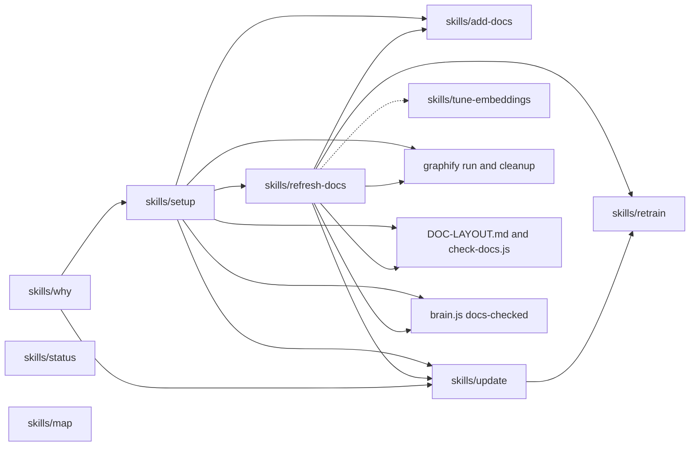

# Modules

Each row is one file. "Called by" lists the files that load or run it. Groups follow the communities in `graphify-out/GRAPH_REPORT.md` (names in brackets).

Not listed: `test/` ([03-dev-workflow.md](03-dev-workflow.md)) and `src/thesaurus.json` (a word list read by `rules.js`).

## Entry and hooks

Graph communities: [Brain Context Engine], [Prompt History Hook], [Tips Module].

| File | Job | Main exports | Called by |
|------|-----|--------------|-----------|
| `src/brain.js` | The entry: the prompt hook, the post-tool hook, the `context` text, and the build and status modes. Handles pin commands (`pinNote`). Gathers rules, map and history, then dedupes and writes output. `refreshMapInBackground()` starts one stale map build at a time (lock `mk.lock`) and the hourly `drift` mode. Modes `drift` and `docs-checked <name>` write `drift.json` and `docs-checked.json` ([R37](../business/02-business-rules.md#r37-drift-warning)). `mk-status all` prints each set's graph path and `GRAPH MISSING`. | `build`, `query`, `search`, `searchFull`, `embedNodes`, `format`, `tokens`, `capText`, `contextText`, `skipReason`, `driftNote`, `missNote`, `noteMiss`, `isRepoCodeFile` | `hooks/hooks.json`; the hook commands written by `hosts/codex.js` and `hosts/gemini.js`; `setup.js` build steps; `skills/status`; `eval/eval-rules.js` |
| `src/pin.js` | Reads `gabriel use ...` and keeps the session's pin list in `seen/<session>.pin`. Rules: [R35](../business/02-business-rules.md#r35-session-pin). | `parsePin`, `getPins`, `setPins`, `touchPin`, `nearName`, `MAX_PINS` | `brain.js` |
| `src/tips.js` | Picks one tip per session for the hook note. Off with `"tips": false` in `projects.json`. | `TIPS`, `tipFor` | `brain.js` |
| `src/debuglog.js` | Writes one line per caught error to `debug.log` in the data folder. Only with `GABRIEL_DEBUG=1`. Never throws. | `debug` | `brain.js`, `mk.js` |
| `src/statusview.js` | Builds the status block of one doc set for `mk-status all`, with its `drift` line when given. No file reads. | `statusBlock` | `brain.js` |
| `src/history.js` | Saves each prompt (secrets hidden) to a monthly JSONL file. Finds earlier similar prompts by meaning. | `redact`, `isAutomated`, `append`, `load`, `embedHistory`, `searchHistory`, `formatHistory`, `forget`, `machineId` | `brain.js`, `graphdb.js`, `eval/wide-test.js` |
| `src/graphdb.js` | Keeps a keyword graph of saved prompts in `history/graph.db`. Derived: rebuilt when needed. | `sync`, `related`, `top`, `lexical`, `dbFile` | `brain.js` |

## Hosts

Graph communities: [Claude Host Integration], [Hosts Index and Tests].

| File | Job | Main exports | Called by |
|------|-----|--------------|-----------|
| `src/hosts/index.js` | Lists the adapters and returns one by name. Throws on an unknown name. | `get`, `names` | `brain.js`, `paths.js`, `setup.js` |
| `src/hosts/common.js` | Shared readers: the prompt hook input, the tool input, and the touched path. | `str`, `readCommon`, `toolInput`, `pathsFrom` | every adapter |
| `src/hosts/claude.js` | Claude Code: the plugin hooks. No hook file written (`setup` is null). | adapter object | `hosts/index.js` |
| `src/hosts/codex.js` | Codex CLI: hook entries in its `hooks.json`. Output capped at 9000 characters. | adapter object | `hosts/index.js` |
| `src/hosts/gemini.js` | Gemini CLI: hook entries in its `settings.json`. Timeouts in milliseconds. | adapter object | `hosts/index.js` |
| `src/hosts/copilot.js` | GitHub Copilot: no hook (its hook output is dropped). Uses `brain.js context` from its instructions file. | adapter object | `hosts/index.js` |
| `src/hosts/generic.js` | Any other tool: plain text from `brain.js context`. No rule file loaded by default. | adapter object | `hosts/index.js` |

## Rules graph and folders

Graph communities: [Synonym and Thesaurus], [Project Folder Setup].

| File | Job | Main exports | Called by |
|------|-----|--------------|-----------|
| `src/rules.js` | Reads the rule files and memory notes, makes the rules graph, and scores a prompt by words and synonyms. | `homeDir`, `graphFile`, `dataDir`, `writeAtomic`, `tokens`, `build`, `fresh`, `loadThesaurus`, `wordScores`, `rank`, `query` | `brain.js`, `embed.js`, `dq.js`, `history.js`, `graphdb.js`, `mk.js`, `tune/tune.js`, `train-rank.js` |
| `src/paths.js` | Gives the rules folder (by host), the data folder, and the per-project folders. Checks project names and refuses plugin-folder paths. | `pluginRoot`, `pathKey`, `moveIntoPlace`, `insidePluginCache`, `dataDir`, `rulesHome`, `modelsDir`, `projectsFile`, `docsDir`, `privateDir`, `checkName`, `activeHost`, `setHost`, `hostAdapter`, `defaultRuleFiles`, `contextFile` | almost every module |
| `src/projects.js` | Reads `projects.json`. Gives each project its root, aliases, routing prior, chain settings and other options. Holds the default embedding model name. | `loadConfig`, `loadProjects`, `getProject`, `projectNames`, `hasFiles`, `resolveRoot`, `embedModel`, `DEFAULT_EMBED_MODEL` | `brain.js`, `mk.js`, `rules.js`, `embed.js`, `dq.js`, `setup.js`, `retrain.js`, `train-rank.js`, `tune/`, `eval/suggest-cases.js` |
| `src/thesaurus.json` | Groups of near-equal words for the synonym step. Private extra words come from the data folder. | (data file) | `rules.js` `loadThesaurus` |

## Meaning and the project map

Graph communities: [Search and Refresh], [Embedding Cache], [Doc Chunking and Build], [Document Text Extraction].

| File | Job | Main exports | Called by |
|------|-----|--------------|-----------|
| `src/embed.js` | Loads the local embedding model (never downloads from the hook). Reads and writes `vectors.json`. | `MODEL` (getter), `BASE_MODEL`, `embedText`, `ehash`, `withTimeout`, `getEmbedder`, `readVectors`, `embedNodes` | `brain.js`, `dq.js`, `mk.js`, `setup.js`, `train-rank.js`, `tune/export-pairs.js`, `eval/eval-rerank.js` |
| `src/mk.js` | Builds `mk.db` for one project from its docs and code graph (`build()` checks the graph: [R33](../business/02-business-rules.md#r33-a-code-graph-must-exist-and-match-the-docs)). `namedProjects()` picks the aliases named in a prompt. Runs the spreading search: `search()` runs eleven steps in order (`seedByWords`, `seedByMeaning`, `gateAndNormalize`, `loadLearned`, `spread`, `pickResults`, `addNamedCode`, `pairHandlers`, `rankDocRows`, `addNeighbours`, `addExactLines`), including the two-links-away step. Routes a prompt, and learns from files opened after a map. | `defaultProject`, `projectNames`, `dbFile`, `docsRoot`, `graphPathOf`, `build`, `stale`, `hasMap`, `search`, `searchAll`, `namedProjects`, `format`, `chunkDoc`, `listDocs`, `rankDocs`, `remember`, `touched`, `learnShow`, `learnReset`, `status`, `pairHandlers`, `codeText` | `brain.js`, `setup.js`, `retrain.js`, `train-rank.js`, `tune/tune.js`, `tune/export-pairs.js`, `tune/code-pairs.js`, `eval/eval-model.js`, `eval/eval-rules.js`, `eval/measure-hook.js`, `eval/suggest-cases.js` |
| `src/repo.js` | Checks a doc set's code folder against its graph (`checkRepo()`, at `add-docs --repo`). At prompt time, finds the line where each code name is defined in that folder (`exactLines()`, with `defLine()`). `graphDrift()` counts the commits a graph is behind HEAD and how many of its files changed. Fails open. | `checkRepo`, `defLine`, `exactLines`, `graphDrift`, `lastCommitTime`, `isGitRepo`, `headCommit`, `commitsSince` | `setup.js`, `mk.js`, `eval/eval-map.js` |
| `src/rerank.js` | Optional local reranker. Scores (question, code text) pairs with a tuned model (`local/<name>` in the models folder) and keeps the best pool items. Off unless `rerankModel` is set (`projects.json`, or env `GABRIEL_RERANK_MODEL`). Never throws. | `rerankModel`, `getReranker`, `rerankCode`, `rerankMap`, `richText` | `brain.js` (`mapFor`: `rerankMap`, `getReranker`); `tune/real-pairs.js` (`richText`) |
| `src/extract.js` | Reads one doc file and returns Markdown-like text (headings as `#` lines). Never throws. | `SUPPORTED`, `OPT_IN`, `extSet`, `isDocName`, `skipName`, `extractText`, `pdfHasSupport` | `mk.js`, `setup.js` |
| `src/dq.js` | Question index: embeds the written questions of each doc section into `dq.<project>.bin`. | `embedAll`, `load` | `brain.js` (`build-dq`), `mk.js` |
| `src/make-corpus.js` | Turns downloaded public Markdown docs into a corpus folder for the map. Run by hand. | none (script) | run by hand |

## Setup and data moves

Graph communities: [Setup and Doc Install], [Data Migration].

| File | Job | Main exports | Called by |
|------|-----|--------------|-----------|
| `src/setup.js` | The one-shot setup and the `--update`, `add-docs` and host modes. Installs packages, fetches the model, builds maps, writes host hook files (`--host`, `--apply`). `addDocs()` checks `--code` before any write, and `buildMap()` runs the map build. `relinkDocs()` handles `--relink`. | `main`, `expandHome` | `skills/setup`, `skills/add-docs`, `skills/update` |
| `src/migrate-data.js` | Copies old brain data into the new data folder. Copies and checks; never deletes the source. | `MOVES`, `migrate` | `setup.js`, run by hand |

## Tuning and ranking

Graph communities: [Retrain Script], [Ranking Training], [ONNX Export], [ONNX Export Python], [Model Training Python].

| File | Job | Main exports | Called by |
|------|-----|--------------|-----------|
| `src/retrain.js` | Retrains one project's doc ranking. `keepNew()` applies the keep rule ([R26](../business/02-business-rules.md#r26-retrain-keeps-new-weights-only-when-the-strict-score-does-not-fall)). Runs `eval/eval-map.js` and `train-rank.js` as child processes. | `keepNew` (exported for tests) | `skills/retrain` |
| `src/train-rank.js` | Learns the doc ranking weights from the written questions (no outside model). | none (script) | `retrain.js` |
| `src/tune/tune.js` | Runs the optional meaning-model tune in five steps. Scores a copy of the data. Keeps the model only when `decide` says so, or with `--force`. | `decide`, `parseArgs`, `keepModel`, `caseFilesOf` | `skills/tune-embeddings` |
| `src/tune/export-pairs.js` | Writes training pairs (question and matching section), split by doc file, plus code-name pairs for training only. | `exportPairs`, `mulberry32`, `seededShuffle`, `CODE_CASE_FILES`, `CASE_FILES` | `tune/tune.js` |
| `src/tune/code-pairs.js` | Makes template questions from class names, paired with `codeText()` from `mk.js`. | `codePairs` | `tune/export-pairs.js` |
| `src/tune/export-onnx.js` | Runs `export_onnx.py` with the tune venv Python. | `exportOnnx` | `tune/tune.js` (as a child process) |
| `src/tune/train.py` | Fine-tunes the sentence model on the pairs. Python. | script | `tune/tune.js` |
| `src/tune/export_onnx.py` | Exports the trained model to ONNX and quantizes it. Python. | script | `tune/export-onnx.js` |
| `src/tune/requirements.txt` | Python packages for the tune run. | (data file) | `setup.js --tune` |
| `src/tune/code-desc.js` | Writes a short business description per class and method name to `code-desc.json` in the project's private folder. Runs one `codex exec` call. | `run`, `callLlm`, `parseArgs` | run by hand: `node src/tune/code-desc.js --project <name>` ([TUNING](../../docs/TUNING.md#class-descriptions-code-descjson)); `mk.js` reads the file |
| `src/tune/real-pairs.js` | Makes reranker training pairs from your real labelled questions (`rerank-train-cases.json` in each project's private folder). Writes `pairs.real.jsonl`. | `realPairs` | run by hand: `node src/tune/real-pairs.js --out <dir>`; tests otherwise |
| `src/tune/rerank-pairs.js` | Makes hard-negative reranker training pairs from class and method names. Writes `pairs.rerank.jsonl`. | `rerankPairs`, `scenarioAnchors` | run by hand: `node src/tune/rerank-pairs.js --out <dir>`; tests otherwise |
| `src/tune/train_rerank.py` | Fine-tunes a cross-encoder reranker on the pairs file. Python. Runs on this PC only. Its output goes to `export_onnx.py --kind rerank`. | script | run by hand: `python train_rerank.py --pairs <jsonl> --out <dir>` |

## Eval scripts

Graph communities: [Eval Map Runner], [Model Eval Script], [Rules Eval], [Hook Measure Script], [Case Suggestion], [Wide Fill Tests].

The questions live in each project's private folder, not in git.

| File | Job | Main exports | Called by |
|------|-----|--------------|-----------|
| `eval/eval-map.js` | Scores the default map (or one project, or the real router) on written questions. Prints a summary. `--why` gives each DOC or FAIL a miss class (`section-rank`, `not-in-pool`, `wrong-doc`, `code-only-miss`) and the counts. | `judge`, `judgeRendered` | `retrain.js`, `tune/tune.js`, `eval/eval-rerank.js` |
| `eval/eval-model.js` | Tries another embedding model in a throwaway home, for several similarity floors. | `judge` (script) | run by hand |
| `eval/eval-rerank.js` | Offline A/B test of a rerank idea. Changes no live file. | script | run by hand |
| `eval/eval-rules.js` | Regression check of rules matching on the real rules. When every rule is `inContext`, it skips the rule cases and checks only the `nomap` cases. Exit 1 on a failure. | script | run by hand |
| `eval/measure-hook.js` | Times the real hook in a new process. | script | run by hand |
| `eval/suggest-cases.js` | Suggests one written question per doc section, for review. Never writes the real case file. | `sectionCases`, `covered`, `newSuggestions`, `esc` | `setup.js` (`--update`) |
| `eval/wide-test.js` | Wide test of the rules and history, in a throwaway home. | script | run by hand |

## Tools

Graph communities: [Public Check Script].

| File | Job | Main exports | Called by |
|------|-----|--------------|-----------|
| `tools/check-public.js` | Privacy scan of publishable files: emails, IP addresses, secrets, user paths, owner words. Prints file, line and kind only. | script | `npm run privacy`, `npm run prepack` (`--release`), `test/run-all.js` |
| `tools/check-docs.js` | Checks a docs folder: size, long code blocks, line numbers, placeholders, broken links and, with `--code`, code paths. Prints file and line per hit. Rules: [DOC-LAYOUT](../../docs/DOC-LAYOUT.md). | script | `skills/setup`, `skills/refresh-docs`; run by hand |
| `tools/check-claims.js` | Checks that each backticked path, `name()`, constant and `--flag` in a docs folder exists in the code. A short path matches a repo file that ends with it; home and data-folder paths are skipped; `--ignore` skips named paths. | script | `skills/setup`, `skills/refresh-docs` |
| `tools/key-ideas.js` | Compares a doc copy before a rewrite with the docs after. Lists each code name, link or number that is in no doc after. A removed doc is checked too. | script | `skills/refresh-docs` |
| `tools/graph-stats.js` | Prints a graph's node, link and community counts and `built_at_commit`. Flags dangling links, nodes from excluded folders and, with `--repo`, a commit that is not `HEAD`. | script | `skills/refresh-docs` |

## Plugin manifests and skills

| File | Job |
|------|-----|
| `hooks/hooks.json` | The `UserPromptSubmit` hook (`brain.js hook`, 60 s) and the `PostToolUse` hook (`brain.js touched`, 5 s) for Claude Code. |
| `.claude-plugin/plugin.json` | Plugin name and version. The version must match `package.json`. |
| `.claude-plugin/marketplace.json` | Marketplace entry. Has no version field. |
| `skills/*/SKILL.md` | Slash commands: `setup`, `update`, `add-docs`, `status`, `map`, `refresh-docs`, `retrain`, `tune-embeddings`, `why`. Each runs one script. The `map` skill only explains the block. |

## How the skills connect

Caption: which skill calls or sends the user to which, and the shared steps they run. An arrow means "runs or points to".

When you change a shared step, update every skill that runs it:

| Shared step | Skills | Also update |
|---|---|---|
| graphify run (update, not rebuild), graph folder outside the code repo, cleanup of `graph.html` and dated backups | `setup`, `refresh-docs`; `update` gives the advice | `docs/AGENT-GUIDE.md` rule 5, W02, W07 |
| Doc checks: `tools/check-docs.js`, `tools/check-claims.js`, `tools/key-ideas.js`, `tools/graph-stats.js` | `setup`, `refresh-docs` | `docs/DOC-LAYOUT.md`, `docs/AGENT-GUIDE.md`, W07 |
| `brain.js docs-checked` (drift warning) | `setup`, `refresh-docs` | [R37](../business/02-business-rules.md#r37-drift-warning), W02, W07 |
| Retrain choice and keep rule | `refresh-docs`, `update`, `retrain` | [R26](../business/02-business-rules.md#r26-retrain-keeps-new-weights-only-when-the-strict-score-does-not-fall), W06 |
| `add-docs` options (`--code`, `--repo`, `--relink`) | `add-docs`, `setup`, `refresh-docs` | W03 |
| Agent rules, how to run each skill, finish checklist, known errors | `setup`, `add-docs`, `refresh-docs`, `update`, `retrain`, `tune-embeddings` (each points to it) | `docs/AGENT-GUIDE.md` (its "Run each skill" table: one row per skill), README "For AI agents" |

The dotted arrow: `refresh-docs` names `tune-embeddings` only to say it is not run.
